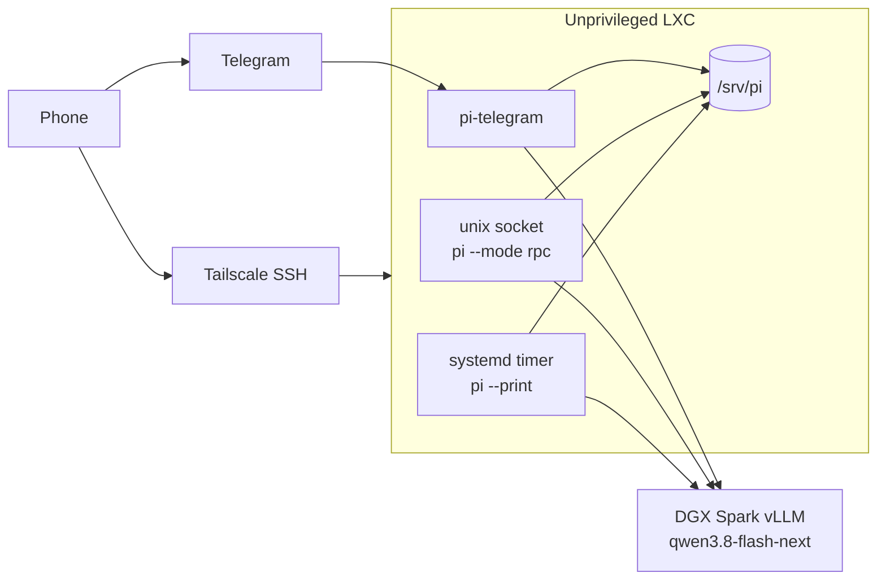

I wanted a coding agent I can reach from my phone, on a model that stays on hardware I control, with no ports forwarded in from the internet. Pi runs in an unprivileged Proxmox LXC. Telegram is the phone client. vLLM on a DGX Spark serves `qwen3.8-flash-next`. Tailscale SSH is the fallback when I want a real shell.

This is that build. The container is disposable. The agent state is not. Five things failed on the way up, and they are at the bottom so you can skip them until they happen to you.

## Why

Three constraints, in the order I actually care about them.

**I want it on my phone.** A coding agent that only exists in a terminal on my desk gets used when I am at the desk. Telegram is already in my pocket. I message a bot, the bot runs [Pi](https://github.com/earendil-works/pi), and the reply comes back in the same chat. `/status`, `/new`, `/abort`, `/model`, and `/cron` are the whole remote control surface.

**The model stays local.** Print mode, RPC mode, and the Telegram bridge all call the same provider: an OpenAI-compatible endpoint on a DGX Spark, running vLLM, serving `qwen3.8-flash-next`. There is no cloud model key in this setup. Prompts, tool output, and the repo the agent is working in stay on the LAN.

**Nothing is published.** The agent does not bind a TCP port. Its RPC listener is a unix socket, mode `600`, owned by the `pi` user. Telegram is an outbound long-poll. SSH rides Tailscale. I do not port-forward the container, and I do not put the bot token in a URL to "just test it."

## Architecture

One unprivileged LXC on Proxmox. Nesting and `keyctl` are on. A second disk is mounted at `/srv/pi` and holds everything that has to survive a rebuild. Inside, Node 22 and [`@earendil-works/pi-coding-agent`](https://www.npmjs.com/package/@earendil-works/pi-coding-agent). Three ways to talk to Pi, one model config:

| Path | How it runs | When I use it |
|---|---|---|
| `pi-rpc.service` | `socat` listens on `/run/pi-agent/rpc.sock` and execs `pi --mode rpc` per connection | Local clients, smoke tests |
| `pi-telegram.service` | [`pi-telegram`](https://www.npmjs.com/package/pi-telegram) (`pitg`) spawns `pi --mode rpc` for each chat | The phone |
| `pi-routine@.service` | A systemd timer runs `pi --print --no-session` on a prompt file | Scheduled jobs, no one logged in |
| `tailscaled` | Tailscale SSH to the container | Interactive `pi` when I want the TUI |

The bridge has an allowlist, and the entries are numeric Telegram user ids. A quoted string does not match `from.id`. The bot replies Unauthorized and never runs the prompt. The service still looks healthy. Details are in the gotchas.



`pitg` does not attach to the socket. It starts its own `pi --mode rpc`. The socket is there for anything else on the box. The timers do not go through RPC at all. All three still read the same directory, because `PI_CODING_AGENT_DIR` points at `/srv/pi/config`. That directory holds a custom provider, `spark-vllm`, with `api: openai-completions` and a base URL on the Spark. Default model is `qwen3.8-flash-next`.

`/srv/pi` is a Proxmox mount point (`mp0`), not a directory on the container root disk.

| Path | What lives there |
|---|---|
| `/srv/pi/config` | `PI_CODING_AGENT_DIR`: `models.json`, `settings.json` |
| `/srv/pi/sessions` | `PI_CODING_AGENT_SESSION_DIR` |
| `/srv/pi/workspace` | The git repo Pi's cwd is set to |
| `/srv/pi/home` | Home directory of user `pi`, including `.pi/telegram` |
| `/srv/pi/logs` | Routine output |
| `/srv/pi/routines` | One `<name>.prompt` file per routine |

Destroy the container later if you want. Keep the mount-point disk and reattach it. The bot config, sessions, and workspace come back.

## Before you start

What I ran this against, on 22 Oct 2026:

| Piece | Value |
|---|---|
| Proxmox | VE 9.2 |
| Guest | Debian 13 standard, unprivileged, `nesting=1,keyctl=1` |
| Size | 2 cores, 4 GB RAM, 2 GB swap, 32 GB root, 32 GB on `/srv/pi` |
| Node | 22 (v22.23.4). Pi wants 22.19 or newer |
| Agent | `@earendil-works/pi-coding-agent` 1.4.0, binary `pi` |
| Bridge | `pi-telegram` 0.5.0, binary `pitg` |
| Model | Provider `spark-vllm`, model `qwen3.8-flash-next`, 262144 context in config |
| Inference | vLLM on the DGX Spark, OpenAI-compatible `/v1` on port 8000 |

You need a Proxmox host, a tailnet, a bot token from BotFather, and your numeric Telegram user id (I get mine from `@userinfobot`). The Spark, or whatever is serving the model, has to be reachable from the container on the LAN. Confirm that before blaming Pi:

```bash
curl -sS "http://<SPARK_IP>:8000/v1/models"
```

Use the model id that endpoint returns. Mine is `qwen3.8-flash-next`. If vLLM is also serving something else, add another entry under `models` and switch later with `/model` in Telegram.

Secrets stay in a secret store. I keep the Tailscale auth key and the bot token in Vault, under generic paths along the lines of `secret/homelab/tailscale` and `secret/homelab/telegram`. The host-side script reads a Vault token from a root-only file, renders an env file, pushes it into the container at mode `0600`, and shreds the temp file. The token never goes on the command line. After setup I delete the token file. A hand-written env file works too. Either way it looks like this, with your own values:

```bash
# /etc/pi-agent/pi.env  (mode 0600, root)
TS_AUTHKEY=<TAILSCALE_AUTHKEY>
PI_TELEGRAM_TOKEN=<TELEGRAM_BOT_TOKEN>
PI_CODING_AGENT_DIR=/srv/pi/config
PI_CODING_AGENT_SESSION_DIR=/srv/pi/sessions
PI_SKIP_VERSION_CHECK=1
PI_TELEMETRY=0
HOME=/srv/pi/home
```

`PI_SKIP_VERSION_CHECK` and `PI_TELEMETRY` keep a headless box from phoning home on startup. `HOME` is set so the service user writes into the persistent volume, not a home directory on the root disk.

Push it before the install script. The units use `EnvironmentFile=`, and they will not start without it.

```bash
umask 077
pct exec "$VMID" -- mkdir -p /etc/pi-agent
pct push "$VMID" ./pi.env /etc/pi-agent/pi.env --perms 0600
shred -u ./pi.env
pct exec "$VMID" -- awk -F= 'NF<2{next} $2==""{print "EMPTY:", $1; next} {print "SET:", $1}' /etc/pi-agent/pi.env
```

That last command prints key names only. `SET` or `EMPTY`. It does not print values.

## 1. Create the LXC

Run this on the Proxmox host as root. `local` and `local-lvm` are the stock storage names. Use whatever `pvesm status` shows on your node. If `pveam download` fails because a directory storage was created with mkdir disabled, create a `template/cache` directory on that storage and retry.

```bash
#!/bin/bash
# Run on the Proxmox host as root.
set -euo pipefail

NAME=pi-agent
TEMPLATE_STORAGE=local
DATA_STORAGE=local-lvm
BRIDGE=vmbr0

pveam update
TPL=$(pveam available --section system | awk '{print $2}' | grep -E '^debian-13-standard_.*amd64' | sort -V | tail -1)
pveam download "$TEMPLATE_STORAGE" "$TPL"

VMID=$(pvesh get /cluster/nextid)
while pct status "$VMID" &>/dev/null || qm status "$VMID" &>/dev/null; do
  VMID=$((VMID + 1))
done

pct create "$VMID" "${TEMPLATE_STORAGE}:vztmpl/${TPL}" \
  --hostname "$NAME" \
  --unprivileged 1 \
  --features nesting=1,keyctl=1 \
  --cores 2 \
  --memory 4096 \
  --swap 2048 \
  --rootfs "${DATA_STORAGE}:32" \
  --mp0 "${DATA_STORAGE}:32,mp=/srv/pi,backup=1" \
  --net0 "name=eth0,bridge=${BRIDGE},ip=dhcp,firewall=0" \
  --onboot 1 \
  --ostype debian \
  --timezone America/Toronto \
  --description "Headless Pi coding agent"

# Tailscale needs /dev/net/tun. An unprivileged LXC does not have it.
cat >> "/etc/pve/lxc/${VMID}.conf" <<'CONF'
lxc.cgroup2.devices.allow: c 10:200 rwm
lxc.mount.entry: /dev/net/tun dev/net/tun none bind,create=file
CONF

pct start "$VMID"
echo "VMID=${VMID}"
```

`--features nesting=1,keyctl=1` is the same pair I use on any unprivileged container that does more than run a static binary. Nesting lets processes inside create nested namespaces. `keyctl` keeps keyrings from failing closed. The two `lxc.*` lines are specifically for Tailscale. `/dev/net/tun` is major 10, minor 200. Skip them and `tailscale up` dies inside the container with a missing tun device. Add them before the first boot.

`mp0` is the line that matters for the next time you rebuild. The disk is something like `<DATA_STORAGE>:vm-<VMID>-disk-1`, mounted at `/srv/pi`, and `backup=1` includes it in Proxmox backups. Those backups contain the bot token once the bridge has started. Treat them as secret.

To rebuild, destroy the container without destroying unreferenced disks, then:

```bash
pct set <VMID> --mp0 <DATA_STORAGE>:vm-<OLD_VMID>-disk-1,mp=/srv/pi,backup=1
```

Change the timezone if you are not in Toronto. The routine timer and the bridge cron both use it.

## 2. Install inside the container

Push the script and run it as root in the container. It is idempotent. Config files are created only if they are missing, so a rerun will not clobber a `models.json` you edited. Unit files are rewritten every time.

```bash
pct push "$VMID" ./setup.sh /root/setup.sh
pct exec "$VMID" -- bash /root/setup.sh
```

```bash
#!/bin/bash
# Runs INSIDE the container as root. Idempotent.
set -euo pipefail
export DEBIAN_FRONTEND=noninteractive

apt-get update -qq
apt-get install -y -qq curl ca-certificates git gnupg socat jq ripgrep

if ! node -v 2>/dev/null | grep -q '^v2[2-9]'; then
  curl -fsSL https://deb.nodesource.com/setup_22.x | bash -
  apt-get install -y -qq nodejs
fi

npm install -g @earendil-works/pi-coding-agent@1.4.0 pi-telegram@0.5.0

if ! command -v tailscale >/dev/null; then
  curl -fsSL https://tailscale.com/install.sh | sh
fi
systemctl enable --now tailscaled

if ! id pi &>/dev/null; then
  useradd -r -m -d /srv/pi/home -s /bin/bash pi
fi
mkdir -p /srv/pi/{config,sessions,workspace,home,logs,routines}

# Local Qwen on the Spark. apiKey is a dummy: this vLLM does not check one.
# Replace <SPARK_IP> before running, and use the id from GET /v1/models.
if [ ! -f /srv/pi/config/models.json ]; then
  cat > /srv/pi/config/models.json <<'EOF'
{
  "$schema": "https://pi.dev/schemas/models.schema.json",
  "providers": {
    "spark-vllm": {
      "name": "DGX Spark vLLM (local Qwen)",
      "baseUrl": "http://<SPARK_IP>:8000/v1",
      "api": "openai-completions",
      "apiKey": "local-vllm",
      "models": [
        {
          "id": "qwen3.8-flash-next",
          "name": "Qwen3.8 Flash Next (Spark)",
          "contextWindow": 262144,
          "maxTokens": 16384,
          "input": ["text"],
          "cost": { "input": 0, "output": 0, "cacheRead": 0, "cacheWrite": 0 }
        }
      ]
    }
  }
}
EOF
fi

if [ ! -f /srv/pi/config/settings.json ]; then
  printf '%s\n' '{"defaultProvider":"spark-vllm","defaultModel":"qwen3.8-flash-next"}' \
    > /srv/pi/config/settings.json
fi

if [ ! -d /srv/pi/workspace/.git ]; then
  git -C /srv/pi/workspace init -q
fi

install -d -o pi -g pi -m 750 /srv/pi
for d in config sessions workspace home logs routines; do
  chown -R pi:pi "/srv/pi/$d"
done

# 123456789 stands in for <YOUR_TELEGRAM_ID>.
# It must be a JSON number. Do not quote it.
TG=/srv/pi/home/.pi/telegram
mkdir -p "$TG"
if [ ! -f "$TG/settings.json" ]; then
  cat > "$TG/settings.json" <<'EOF'
{
  "bots": [
    {
      "token": "__FROM_ENV__",
      "name": "pi-agent",
      "allowedUsers": [123456789],
      "cwd": "/srv/pi/workspace",
      "streamByChat": {}
    }
  ],
  "idleTimeoutMs": 600000,
  "maxResponseLength": 4000,
  "language": "en",
  "cron": {
    "enabled": true,
    "defaultTimezone": "America/Toronto",
    "maxJobsPerChat": 20,
    "maxRunSeconds": 900,
    "maxLatenessMs": 600000,
    "retryMax": 2,
    "retryBackoffMs": 30000
  }
}
EOF
fi
chown -R pi:pi /srv/pi/home
chmod 600 "$TG/settings.json"

cat > /usr/local/bin/pi-routine <<'EOF'
#!/bin/bash
# pi-routine <name>  ->  /srv/pi/routines/<name>.prompt via pi --print
set -eo pipefail
N=$1
P=/srv/pi/routines/$N.prompt
cd /srv/pi/workspace
{
  echo "=== $(date -Is) $N"
  pi --print --no-session "$(cat "$P")"
} >> "/srv/pi/logs/$N.log" 2>&1
EOF
chmod 755 /usr/local/bin/pi-routine

if [ ! -f /srv/pi/routines/daily-git-status.prompt ]; then
  cat > /srv/pi/routines/daily-git-status.prompt <<'EOF'
Run `git -C /srv/pi/workspace status --short --branch` and `git -C /srv/pi/workspace log --oneline -5` and give a 3-line summary of the workspace state.
EOF
fi
chown -R pi:pi /srv/pi/routines

cat > /usr/local/bin/pi-telegram-config <<'EOF'
#!/bin/bash
# Inject the bot token from the environment. The file stays mode 0600 on /srv/pi.
F=$HOME/.pi/telegram/settings.json
[ -n "${PI_TELEGRAM_TOKEN:-}" ] || { echo "PI_TELEGRAM_TOKEN empty" >&2; exit 1; }
jq --arg t "$PI_TELEGRAM_TOKEN" '.bots[0].token=$t' "$F" > "$F.tmp"
chmod 600 "$F.tmp"
mv "$F.tmp" "$F"
EOF
chmod 755 /usr/local/bin/pi-telegram-config

cat > /etc/systemd/system/pi-rpc.service <<'EOF'
[Unit]
Description=Pi coding agent (headless RPC on unix socket /run/pi-agent/rpc.sock)
After=network-online.target
Wants=network-online.target

[Service]
User=pi
Group=pi
EnvironmentFile=/etc/pi-agent/pi.env
WorkingDirectory=/srv/pi/workspace
RuntimeDirectory=pi-agent
ExecStart=/usr/bin/socat UNIX-LISTEN:/run/pi-agent/rpc.sock,fork,mode=600 EXEC:"/usr/bin/pi --mode rpc",stderr
Restart=always
RestartSec=5

[Install]
WantedBy=multi-user.target
EOF

# pitg on PATH is a symlink, and its main-module check fails through a symlink.
# Call the real file. See the gotchas.
cat > /etc/systemd/system/pi-telegram.service <<'EOF'
[Unit]
Description=Pi-Telegram bridge (pitg) to pi via RPC
After=network-online.target
Wants=network-online.target
ConditionPathExists=/etc/pi-agent/telegram.enabled

[Service]
User=pi
Group=pi
EnvironmentFile=/etc/pi-agent/pi.env
WorkingDirectory=/srv/pi/workspace
ExecStartPre=/usr/local/bin/pi-telegram-config
ExecStart=/usr/bin/node /usr/lib/node_modules/pi-telegram/dist/main.js
Restart=always
RestartSec=10

[Install]
WantedBy=multi-user.target
EOF

cat > /etc/systemd/system/pi-routine@.service <<'EOF'
[Unit]
Description=Pi routine %i (pi --print)

[Service]
Type=oneshot
User=pi
Group=pi
EnvironmentFile=/etc/pi-agent/pi.env
ExecStart=/usr/local/bin/pi-routine %i
TimeoutStartSec=900
EOF

cat > /etc/systemd/system/pi-routine-daily-git-status.timer <<'EOF'
[Unit]
Description=Daily 08:00 workspace git summary

[Timer]
OnCalendar=*-*-* 08:00:00
Persistent=true
Unit=pi-routine@daily-git-status.service

[Install]
WantedBy=timers.target
EOF

systemctl daemon-reload
systemctl enable --now pi-rpc.service pi-routine-daily-git-status.timer
systemctl enable pi-telegram.service

set -a
. /etc/pi-agent/pi.env
set +a
if [ -n "${TS_AUTHKEY:-}" ] && ! tailscale status &>/dev/null; then
  umask 077
  KF=$(mktemp -p /run)
  printf '%s' "$TS_AUTHKEY" > "$KF"
  tailscale up --auth-key="file:${KF}" --ssh --hostname=pi-agent || true
  shred -u "$KF"
fi

echo SETUP_DONE
```

`contextWindow` is set to `262144` because that is what this vLLM process was started with. If yours is smaller, change the number. Pi will believe whatever you write here. Cost is all zeros because the tokens are mine.

`pi-telegram.service` is enabled and not started. It stays that way until `/etc/pi-agent/telegram.enabled` exists, so a half-configured bot does not poll Telegram.

A one-shot from the host, still inside the container, to prove the model path before any phone is involved:

```bash
pct exec "$VMID" -- systemd-run --wait --pipe \
  -p User=pi \
  -p EnvironmentFile=/etc/pi-agent/pi.env \
  -p WorkingDirectory=/srv/pi/workspace \
  -- pi --print "Reply with exactly PI_SMOKE_OK and nothing else."
```

And the socket, which answers even when Telegram is still off:

```bash
pct exec "$VMID" -- bash -c 'echo "{\"type\":\"get_state\"}" | socat - UNIX-CONNECT:/run/pi-agent/rpc.sock'
```

`get_state` should name `spark-vllm` and `qwen3.8-flash-next`. If it names a cloud default, `PI_CODING_AGENT_DIR` is not reaching the process. If the request errors, the Spark is the first place to look. `curl` the `/v1/models` URL from inside the container. When vLLM is down, Pi fails with it. Restart the vLLM server that is already running on the Spark. Do not start a second copy.

## 3. Headless access from your phone

Two doors. Telegram is the one I use. Tailscale is the one I use when the bridge is the thing that is broken.

### Telegram

Edit `allowedUsers` first. Open `/srv/pi/home/.pi/telegram/settings.json` and replace `123456789` with `<YOUR_TELEGRAM_ID>`, the numeric id from `@userinfobot`. Save it as a number:

```json
"allowedUsers": [123456789]
```

not `"allowedUsers": ["123456789"]`. The guard is `allowedUsers.includes(from.id)` or `allowedUsers.includes(from.username)`. `from.id` is a number. A quoted numeric id matches neither, so the bot replies Unauthorized and drops the prompt. The process stays up the whole time.

Then turn the bridge on. The token has to already be in `/etc/pi-agent/pi.env`.

```bash
pct exec "$VMID" -- touch /etc/pi-agent/telegram.enabled
pct exec "$VMID" -- systemctl restart pi-telegram.service
pct exec "$VMID" -- systemctl status pi-telegram.service --no-pager
```

`ExecStartPre` runs `pi-telegram-config`, which writes the token into `settings.json` and leaves the file at mode `0600`. To rotate it, update the secret store, push a new `pi.env` the same way as before, and `systemctl restart pi-telegram`. You do not edit the token into the unit file.

On the phone: open the bot you created, send `/start`, then a normal sentence. Useful commands, from the bridge:

| Command | What it does |
|---|---|
| `/status` | Current chat and session |
| `/new` | Fresh session |
| `/abort` | Stop the current run |
| `/model` | Pick another model you added |
| `/cron` | Schedule a job inside the bridge |

Bridge cron is stored on the persistent volume, under `~pi/.pi/telegram/cron`. From the chat:

```text
/cron add cron "0 8 * * *" America/Toronto Workspace summary||Summarize git status in /srv/pi/workspace in 3 lines.
```

That schedule lives only as long as `pi-telegram.service` is running. The systemd timer in the next section does not depend on Telegram.

While the bridge is polling, Telegram will not hand those updates to anyone else. `getUpdates` from a browser, a curl, or a second bot process comes back empty, or it conflicts. That is not a broken bot. It is the bridge doing its job. Stop `pi-telegram` if you truly need to inspect the raw queue, and do not put the token in a URL while you are there. Shell history keeps those.

### Tailscale SSH

`tailscale status` inside the container should show the node `pi-agent`. The address is whatever the Tailscale app displays. I am not putting it here, and you should not hardcode it into a phone config if MagicDNS is on.

The tailnet still has to allow SSH. A node can be on the tailnet and still refuse the session. This is the rule I want, as one object in the policy's `ssh` list. `check` asks the user to confirm. `accept` does not.

```json
{
  "action": "check",
  "src": ["autogroup:member"],
  "dst": ["autogroup:self"],
  "users": ["root", "pi"]
}
```

On the phone: Tailscale app connected, then an SSH client. Termius and Blink both work. Host is `pi-agent`. User `root` or `pi`. For the interactive TUI:

```bash
su - pi
cd /srv/pi/workspace
pi
```

The systemd units keep running whether or not that session is open. The TUI is the fallback, not the service.

## 4. A routine, and adding your own

The example ships with the install. `/srv/pi/routines/daily-git-status.prompt` asks Pi for a three-line summary of `git status` and the last five commits. `pi-routine-daily-git-status.timer` fires it at 08:00, with `Persistent=true`, so a container that was off at 08:00 runs the job after it boots. Output is appended to `/srv/pi/logs/daily-git-status.log`.

Fire it once by hand:

```bash
systemctl start pi-routine@daily-git-status.service
tail -n 40 /srv/pi/logs/daily-git-status.log
```

The runner is `pi --print --no-session`. One prompt, no interactive session, no dependency on the unix socket or on Telegram. The same `EnvironmentFile` means it uses `spark-vllm` / `qwen3.8-flash-next` like everything else.

A second routine is a prompt file plus a timer. The template unit `pi-routine@.service` is already installed. Only the timer is new.

```bash
echo 'Check /srv/pi/workspace for TODOs and list the top 5.' \
  > /srv/pi/routines/todo-scan.prompt
chown pi:pi /srv/pi/routines/todo-scan.prompt

cat > /etc/systemd/system/pi-routine-todo-scan.timer <<'EOF'
[Unit]
Description=Weekday TODO scan

[Timer]
OnCalendar=Mon..Fri 09:00
Persistent=true
Unit=pi-routine@todo-scan.service

[Install]
WantedBy=timers.target
EOF

systemctl daemon-reload
systemctl enable --now pi-routine-todo-scan.timer
systemctl start pi-routine@todo-scan.service
```

Name the prompt file `<name>.prompt` and the timer's `Unit=` must be `pi-routine@<name>.service`. The log lands at `/srv/pi/logs/<name>.log`.

I looked at doing this inside Pi instead. [`pi-schedule`](https://pi.dev/packages/pi-schedule), and the related `pi-routines` / `pi-scheduler` packages, install with `pi install npm:...` and run inside a live Pi session. `pi-schedule` fires while that session stays open, and again on the next session start. It does not fire from `pi --print`, and it does not fire from a box where nobody has `pi` open. [`pi-messenger-bridge`](https://pi.dev/packages/pi-messenger-bridge) is the same shape for chat: it is an extension inside an interactive session, and its Telegram auth is a code that shows up in that terminal. There is no terminal on this container once I hang up SSH.

So the headless split is deliberate. Chat is `pi-telegram` under systemd. Schedules are systemd timers. The interactive extensions are there for the Tailscale session, when I want them.

## Gotchas I hit

These are the ones that cost real time. The steps above already include the fixes.

**`pitg` exits 0 when you start it from the symlink.** npm's global bin is a symlink, `/usr/bin/pitg` pointing at `pi-telegram/dist/main.js`. That file only calls `main()` when `import.meta.url` equals `pathToFileURL(process.argv[1])`. `import.meta.url` is the real file. `argv[1]` is the symlink. They differ, `main()` never runs, and Node exits 0. There is no log line. A unit whose `ExecStart` is `pitg` looks like a clean success, and nothing is polling. Call the file directly:

```ini
ExecStart=/usr/bin/node /usr/lib/node_modules/pi-telegram/dist/main.js
```

If `npm root -g` is somewhere else on your image, use that path. Do not point `ExecStart` back at the symlink after an npm upgrade without checking `systemctl status`.

**`allowedUsers` has to be numbers.** `123456789` matches `from.id`. `"123456789"` matches neither the id nor the username, and the bot replies Unauthorized. The service stays active, which sends you looking at tokens and polling. Open the JSON and look at the type, not just the digits.

**`getUpdates` shows nothing once the bridge is polling.** One consumer per bot token. The bridge is that consumer. A second client does not see your messages sitting in a queue, because they are already delivered. Stop `pi-telegram.service` before you debug at the Bot API, then start it again.

**Schedule extensions and `pi-messenger-bridge` need a live session.** They are the wrong tool for "run this at 08:00 even if I am asleep and logged out." Timers and `pi --print` are the headless path. The bridge's own `/cron` is a middle ground: it survives a reboot only because `pi-telegram.service` comes back, and the job files sit on `/srv/pi`.

**Tailscale in an unprivileged LXC needs tun, in the container config on the host.** Not inside the guest. These two lines, in `/etc/pve/lxc/<VMID>.conf`, then a restart of the container:

```text
lxc.cgroup2.devices.allow: c 10:200 rwm
lxc.mount.entry: /dev/net/tun dev/net/tun none bind,create=file
```

`tailscale up` before those lines fails, and the failure looks like a key problem. Check that `/dev/net/tun` exists in the container first.

## What I checked

After the cutover to the Spark, a `pi --print` smoke test came back with the marker I asked for, and RPC `get_state` reported `spark-vllm` / `qwen3.8-flash-next`. The daily git timer ran when I started the oneshot by hand, and the log on `/srv/pi` had the summary. I rebooted the container. `pi-rpc`, `tailscaled`, and the timer were active, the mount was still there, and Tailscale rejoined on its own.

The phone path is the same bot you just enabled: `/start`, then a prompt. If that works, and `ss -lnt` inside the container does not show Pi listening on a TCP port, the shape is the one I wanted. A coding agent on the phone, a local model, and no public port.

Pi's RPC protocol, if you want to drive the socket from something that is not Telegram, is documented at <https://pi.dev/docs/latest/rpc>. The command reference that matches the binary you installed is `pi --help`.
