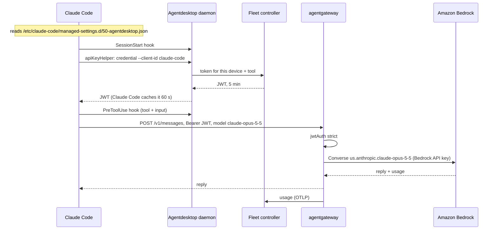

Claude Code reads settings from several places. For a managed machine, one of them matters most: the **managed settings**. The user can't override them, and they're the right place to answer three questions:

- **Where do requests go?** To the gateway, not to Anthropic directly.
- **Where does the key come from?** From a command that returns a short-lived token, not from a file.
- **What do we learn?** Every session and tool call, reported as it happens.

[Agentdesktop](https://github.com/agentdesktop-dev/agentdesktop) writes that file for me, and [agentgateway](https://agentgateway.dev) sends the requests to Claude on Amazon Bedrock. Device sign-in (Entra ID behind Dex) is the same as in [the Copilot CLI post](/articles/2026-10-30-copilot-cli-agentdesktop-agentgateway-entra/). This one is about Claude Code itself, plus the day Bedrock stopped answering.

## Architecture



## 1. The managed settings file

Agentdesktop writes this file from the fleet policy. Claude Code reads every file in `/etc/claude-code/managed-settings.d/`, and a user can't override them from `~/.claude`.

```json
{
  "apiKeyHelper": "'/usr/local/bin/agentdesktop' '--socket' '/run/agentdesktop/agentdesktop.sock' 'credential' '--client-id' 'claude-code'",
  "env": {
    "ANTHROPIC_BASE_URL": "http://127.0.0.1:4002/",
    "CLAUDE_CODE_API_KEY_HELPER_TTL_MS": "60000"
  },
  "companyAnnouncements": ["Managed by Agentdesktop · fleet goose-agentdesk"],
  "hooks": {
    "SessionStart": [{ "matcher": "", "hooks": [{ "type": "command",
      "command": "/usr/local/bin/agentdesktop",
      "args": ["--socket", "/run/agentdesktop/agentdesktop.sock", "hook", "claude-session-start"] }] }],
    "PreToolUse": [{ "matcher": "", "hooks": [{ "type": "command",
      "command": "/usr/local/bin/agentdesktop",
      "args": ["--socket", "/run/agentdesktop/agentdesktop.sock", "hook", "claude-pre-tool-use", "--include-input"] }] }]
  }
}
```

Line by line:

- **`apiKeyHelper`** is the only credential Claude Code ever sees: whatever this command prints. It asks the local daemon for a token for client `claude-code`.
- **`CLAUDE_CODE_API_KEY_HELPER_TTL_MS: 60000`** makes Claude Code ask again every minute. The tokens live five minutes, so a revoked device stops working within five minutes, not days.
- **`ANTHROPIC_BASE_URL`** points at agentgateway on loopback. Claude Code speaks the Anthropic Messages API, and the gateway takes it from there.
- **`hooks`** report each session start and each tool call (with its input) to the daemon. That's where the `session.new`, `tool.use` and `tool.use.input` telemetry events come from.
- **`companyAnnouncements`** puts the line in Claude Code's startup banner, so you can tell at a glance that the machine is managed.

The policy that produces this file is short:

```yaml
llmGateway:
  url: http://127.0.0.1:4002
  authentication:
    type: controllerJwt
    audience: agentgateway
    allowedClientIds: [claude-code, claude-desktop, codex, opencode, pi]

programs:
  claudeCode:
    useLlmGateway: true
    companyAnnouncements: ["Managed by Agentdesktop · fleet goose-agentdesk"]

telemetry:
  events: [session.new, tool.use, tool.use.input]
```

## 2. agentgateway: Claude names to Bedrock models

Claude Code asks for models by Anthropic name: `claude-opus-5-5` by default, plus Sonnet and Haiku for side tasks. The gateway maps each name to a Bedrock model:

```yaml
llm:
  gateways: gateway
  policies:
    jwtAuth:
      mode: strict
      issuer: agentdesktop-controller
      audiences: [agentgateway]
      jwks:
        url: http://127.0.0.1:8080/.well-known/jwks.json
  models:
    - name: claude-opus-5-5
      provider: bedrock
      params:
        model: us.anthropic.claude-opus-5-5
        awsRegion: us-east-1
        apiKey: "$BEDROCK_API_KEY"
    - name: claude-sonnet-5-5
      provider: bedrock
      params:
        model: us.anthropic.claude-sonnet-5-5
        awsRegion: us-east-1
        apiKey: "$BEDROCK_API_KEY"
    - name: claude-haiku-4-5
      provider: bedrock
      params:
        model: us.anthropic.claude-haiku-4-5-20251001-v1:0
        awsRegion: us-east-1
        apiKey: "$BEDROCK_API_KEY"
```

Because the user can't change the model mapping or the key, it's also a kill switch. Remove a model name and Claude Code can't use it anywhere.

## 3. The day Bedrock said "not available for this account"

One morning the nightly test went red: Claude Code returned nothing. Claude Desktop showed the real error:

```text
API Error: 403 anthropic.claude-sonnet-5-5 is not available for this account.
```

That reads like a model-access problem. It wasn't. Running Claude Code with debug output showed the actual reason behind the retries:

```text
Model access is denied due to INVALID_PAYMENT_INSTRUMENT: A valid payment
instrument must be provided. Your AWS Marketplace subscription for this model
cannot be completed at this time.
```

The gateway was signing requests with an IAM access key whose AWS account could no longer pay for Marketplace models. Rolling back to older Claude models didn't help: the same call failed for them minutes later.

The fix was to give the gateway a different credential, not to change the model. A **Bedrock API key** that was already in Vault goes in as the model's `apiKey`, and agentgateway sends it as a bearer token instead of a SigV4 signature. Before changing the gateway, I tested it on its own:

```bash
curl -s "https://bedrock-runtime.us-east-1.amazonaws.com/model/us.anthropic.claude-sonnet-5-5/converse" \
  -H "Authorization: Bearer $BEDROCK_API_KEY" -H 'content-type: application/json' \
  -d '{"messages":[{"role":"user","content":[{"text":"say ok"}]}],"inferenceConfig":{"maxTokens":5}}'
```

Claude Code didn't change at all: same managed settings, same model names. Only the gateway's credential did. That's the point of keeping the provider credential in one place.

## Checking that it works

```bash
# Managed, and from the right file
ls /etc/claude-code/managed-settings.d/
claude -p "Reply with exactly: ok"

# The token apiKeyHelper gets (a JWT, gone in five minutes)
agentdesktop --socket /run/agentdesktop/agentdesktop.sock credential --client-id claude-code | cut -c1-20

# The gateway logged Claude Code and where it went
docker logs agentgateway 2>&1 | grep 'llm.client="claude-code"' | tail -1
```

In the fleet controller's usage view, sessions and tool calls show up next to tokens, so you can see the work behind a bill, not just its size.

## Gotchas

**Claude Code prints nothing in scripts.** On a 403 it retries quietly, up to ten times, then gives up. `claude -p` in a script returns empty output, which looks like a hang. To see the real error, run it with `--debug-to-stderr`, or look at the gateway's log.

**"Not available for this account" isn't always model access.** Check the Bedrock call directly, with the same credential, before you touch model access settings. Mine was billing.

**Model names are Claude Code's, not Bedrock's.** The names on the gateway must be what Claude Code sends (`claude-opus-5-5`), mapped to Bedrock's names (`us.anthropic.claude-opus-5-5`). A name with no mapping falls through to whatever catch-all route you have, or fails.

**A setting you put in `~/.claude` doesn't take.** That's the design: managed settings win. Change the fleet policy instead and the controller pushes it out.

**The credential is the device's.** Revoking a device in the fleet controller stops Claude Code within five minutes. It can't get a new token, and the one it holds expires.

## Wrap-up

Claude Code's managed settings decide where it sends requests and how it gets credentials. They also report what it does. Agentdesktop keeps that file correct, agentgateway keeps the provider credential, and when that credential broke, fixing one gateway setting fixed every machine.
