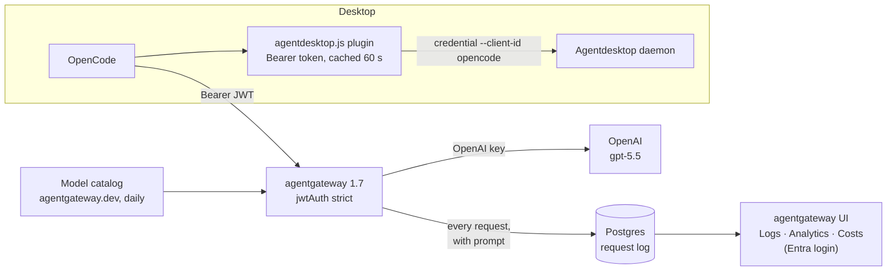

The first question anyone asks about an AI coding tool is "what does it cost?" The second is "what is it actually sending?" A provider dashboard answers neither for a team: it shows one key's spend, not which tool, which person, or which prompt.

This post answers both for [OpenCode](https://opencode.ai):

- **The provider key lives only in agentgateway.** OpenCode runs on GPT-5.5, and the OpenAI key never reaches the desktop.
- **Agentdesktop configures OpenCode.** [Agentdesktop](https://github.com/agentdesktop-dev/agentdesktop) writes its config and a small plugin that adds a fresh token to each request.
- **agentgateway records every call.** [agentgateway](https://agentgateway.dev) 1.7 logs the user, the tool, the prompt, tokens, latency and cost, and shows them in its UI behind Entra ID.

Device sign-in is the same as in [the Copilot CLI post](/articles/2026-10-30-copilot-cli-agentdesktop-agentgateway-entra/). This one is about what you can see afterwards.

## Architecture



## 1. OpenCode, locked to one provider

Agentdesktop writes `/etc/opencode/opencode.jsonc`, the system-wide config:

```jsonc
// Managed by Agentdesktop. Manual changes will be replaced.
{
  "$schema": "https://opencode.ai/config.json",
  "enabled_providers": ["agentdesktop"],
  "model": "agentdesktop/gpt-5.5",
  "plugin": ["file:///etc/opencode/plugins/agentdesktop.js"],
  "provider": {
    "agentdesktop": {
      "name": "Agentdesktop",
      "npm": "@ai-sdk/openai",
      "models": { "gpt-5.5": { "name": "GPT-5.5 (OpenAI via Agentdesktop)" } },
      "options": {
        "apiKey": "agentdesktop-managed",
        "baseURL": "http://127.0.0.1:4002/v1"
      }
    }
  }
}
```

Two settings do the work:

- **`enabled_providers: ["agentdesktop"]`** hides every other provider. As long as the user can't edit `/etc/opencode`, they can't point OpenCode straight at OpenAI with a personal key.
- **`apiKey: "agentdesktop-managed"`** is a placeholder. The real credential comes from the plugin.

## 2. A plugin instead of a key

OpenCode plugins can change request headers. Agentdesktop's plugin asks the local daemon for a token and keeps it for a minute:

```js
const command = ["/usr/local/bin/agentdesktop", "--socket",
  "/run/agentdesktop/agentdesktop.sock", "credential", "--client-id", "opencode"];

export const Agentdesktop = async () => ({
  "chat.headers": async (input, output) => {
    if (input.model.providerID !== "agentdesktop") return;
    output.headers.Authorization = `Bearer ${await credential()}`;   // cached 60 s
  },
});
```

The token is the fleet controller's five-minute JWT, which names the device, the user and the tool (`opencode`). Agentdesktop owns both files ("Manual changes will be replaced"). Revoke the device and the next refresh fails.

The policy behind it:

```yaml
programs:
  openCode:
    useLlmGateway: true
    model: gpt-5.5
    models:
      gpt-5.5:
        name: GPT-5.5 (OpenAI via Agentdesktop)
```

## 3. agentgateway: the key, and a record of every call

The OpenAI route holds the only key:

```yaml
llm:
  models:
    - name: gpt-5.5
      provider: openAI
      params:
        model: gpt-5.5
        apiKey: "$OPENAI_API_KEY"
```

The record-keeping is in `config` and `frontendPolicies`:

```yaml
config:
  # Every request goes to Postgres: the UI's Logs, Analytics and Costs read it.
  database:
    url: $AGW_DB_URL
  # Who and which tool, as the analytics dimensions.
  standardAttributes:
    user: jwt.email
    group: jwt.client_id
  # Prices, from a file the gateway can rewrite (see below).
  modelCatalog:
    - file: /var/lib/agentgateway/catalog/base-costs.json

frontendPolicies:
  accessLog:
    database:
      llm: full    # keep prompts and completions, not just metadata
```

`group: jwt.client_id` is the setting that makes this work for a team. Each tool has its own client ID, so Analytics grouped by *group* shows OpenCode, Claude Code, Codex, Pi and Copilot CLI side by side. Grouped by *user*, it shows the Entra identity behind each request.

`llm: full` is a choice, not a default. It puts conversation text in your database. On a lab box that's what I want. On a team, decide who can read the log first.

## 4. Prices that stay current

Cost is tokens times the catalog price, so a stale catalog gives you wrong numbers. agentgateway can fetch the latest catalog from agentgateway.dev (948 models from 21 providers when I ran it). It writes it to the file named in `modelCatalog` and reloads. The UI's **Refresh** button does that, and so does the admin API. I call the API from a daily systemd timer:

```ini
# agentdesk-agw-catalog-refresh.service (run by a daily timer)
[Service]
Type=oneshot
ExecStart=/usr/bin/curl -fsS -m 120 -X POST http://127.0.0.1:15002/api/costs/refresh-base
```

Seed the file once at deploy (`curl -fsSL https://agentgateway.dev/model-catalog -o base-costs.json`), and let the timer keep it current. Because it changes daily, don't treat the file as drift.

## 5. The UI, behind Entra ID

The gateway UI shows prompts, so it needs a login. agentgateway 1.7 can attach the UI to its own listener and protect it with OIDC:

```yaml
gateways:
  ui:
    port: 15102
    bindAddress: 127.0.0.1

ui:
  gateways: ui
  policies:
    oidc:
      issuer: https://login.microsoftonline.com/<tenant-id>/v2.0
      clientId: <ui-app-client-id>
      clientSecret: $ENTRA_UI_CLIENT_SECRET
      redirectURI: http://localhost:15102/oauth/callback
      scopes: [profile, email]
      sessionTtl: 12h
```

Set `OIDC_COOKIE_SECRET` (64 hex characters, `openssl rand -hex 32`) in the gateway's environment, and require assignment on the Entra app so only the people you add can open it.

## What you get

- **Logs:** every OpenCode request, with model, status, duration, time to first token, tokens in and out, cache hits, the prompt and the answer. You can download any of them as JSON.
- **Analytics:** requests, tokens, cost and latency over time, grouped by tool, user, model or provider.
- **Costs:** the catalog in use, and the price behind every number.

The same data is available from the admin API, which is handy for a quick check from the shell:

```bash
curl -s -X POST http://127.0.0.1:15002/api/logs/search \
  -H 'content-type: application/json' -d '{}' |
  jq '.logs[] | select(.genAi.requestModel == "gpt-5.5") | {startedAt, httpStatus, durationMs}' | head
```

## Gotchas

**"request log database is not configured".** The Logs and Analytics pages need `config.database`. Without it they render, but empty, with this error.

**"decode model catalog from GitHub" when refreshing costs.** The published catalog moved to a richer format in 1.7, and 1.6 can't read it. Upgrade the gateway.

**"Save failed … Read-only file system" in the UI.** A config file mounted read-only can't be edited from the UI, and in a GitOps setup that's what you want. Put the setting in git instead (for example `accessLog.database.llm: full` for the prompts checkbox).

**The gateway won't start after adding the UI login.** `OIDC_COOKIE_SECRET is required when oidc is configured`. Set it, as 64 hex characters.

**A warning about MCP session keys on 1.7.** 1.7 tries to write a generated session key into the config file. With a read-only file and no MCP, set `config.session.key: disabled`.

**OpenCode ignores your own provider.** That's `enabled_providers` working as intended. Add the model to the fleet policy instead.

## Wrap-up

OpenCode needs nothing from the user: no key and no provider to pick. In exchange you can see everything it sends, who sent it, and what it cost, in one UI that only the right people can open. The same gateway records every other tool on the machine.
