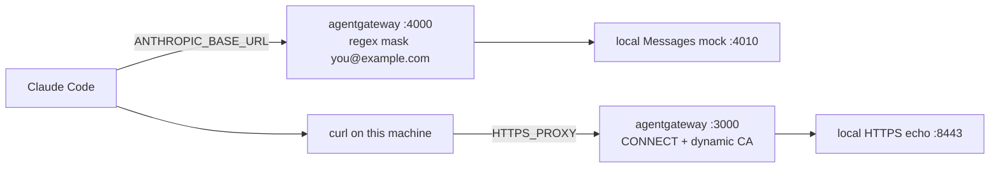

I'm running a localhost [agentgateway](https://agentgateway.dev) 1.7.0 with two listeners. Port 4000 is an Anthropic-compatible Messages API. A regex prompt guard on that listener masks one account address, `you@example.com`, before the request is forwarded. Port 3000 is an HTTP CONNECT proxy. It terminates HTTPS with a local inspect CA and replaces `User-Agent` with `claude-code/egress` before a local echo server sees the request. The lab is on the machine in front of you. The inspect CA is for that machine, and the steps below are how you trust it locally. The point of the setup is that consumers talk to Claude through the proxy, and Claude's own outbound curl talks to the internet through the same process, instead of calling the provider or the public web directly.

<video controls playsinline muted preload="metadata" style="width:100%;height:auto;border-radius:8px" aria-label="Explainer of the Claude Code User-Agent email leak and the two agentgateway hops">
<source src="/videos/agentgateway-claude-email-ua.mp4" type="video/mp4">
Your browser does not support the video tag.
</video>

The clip walks through the Claude Code User-Agent email leak and the two agentgateway hops: a prompt-guard mask on the LLM request, then an inspected egress hop that rewrites `User-Agent`. The address in the video is a fake example, `you@example.com`.

## Why a proxy between Claude and everything downstream

I want Claude Code, and whatever app or agent comes after it, talking to agentgateway. The gateway is the thing that calls Claude. The same process is the thing that carries curl out to the web. Calling `https://api.anthropic.com` from the client, or letting that curl dial the site on its own, skips both of those.

This post is the security case. The account email rides in the prompt the client sends, and a model-written curl can put it in `User-Agent` where a third party logs it. On the proxy I can mask that address before the model sees it, or refuse a `User-Agent` that still contains it, before either hop leaves the machine.

The provider credential stays on the gateway. Downstream consumers do not hold the raw Anthropic API key. They send traffic to agentgateway, and `apiKey: "$ANTHROPIC_API_KEY"` on the model is where the provider credential lives.

The rules live there too. The regex prompt guard, the `User-Agent` rewrite, the deny rule, and a hostname allowlist are config on this proxy, not a copy I have to keep in every client. Prompts on the way to Claude, and the egress those tools open, pass through one process, so that is where I look instead of hoping each consumer logged the right thing.

## What was reported

On 5 November 2026, [Claude Code issue #107757](https://github.com/anthropics/claude-code/issues/107757) reported that the signed-in account email was leaving the machine in `User-Agent` while Claude did web requests. Coverage such as [Cyber Security News](https://cybersecuritynews.com/claude-code-leaks-user-email/) picked it up the next day. The reporter's version is 2.1.318, and the report says that leak is why they now get dozens of scam emails. That causal link is the reporter's account. The issue does not include a capture that ties those messages to this header, and the write-up above says the public evidence does not establish it. I'm not treating it as proven.

The mechanism, as an engineer who said they work on Claude Code described it in a comment quoted on that issue, is narrower. People had reported Claude inventing names for things like `@author` tags. Anthropic put the signed-in account email into the model's context so it would stop doing that. When Claude wrote its own `curl`, it sometimes put that address in `User-Agent` as a contact. Some sites ask scripted clients for a contact. Commenters named Wikimedia and SEC EDGAR as examples of that ask. The same note says the next release would remove the account email from model context.

Built-in WebFetch is a different path. Testers reported a generic agent string with no email. One [Hacker News comment](https://news.ycombinator.com/item?id=50385804) showed `Claude-User (claude-code/2.1.318 (cli); +https://support.anthropic.com/)`. A [2.1.318 WebFetch write-up](https://ranthis.com/guides/claude-code-email-user-agent-test) reported `Claude-User (claude-code/2.1.318; +https://support.anthropic.com/)`. The reports that include the address are about commands and scripts the model wrote, which matches what people found in their session logs.

Related reports: [#101659](https://github.com/anthropics/claude-code/issues/101659) (a subagent sent the email in `User-Agent`) and [#81138](https://github.com/anthropics/claude-code/issues/81138).

### The privacy mod, and where it stops

Anthropic shipped `cc-plugin-privacy` in 2.1.317 and later, on by default. The [mod README](https://github.com/anthropics/claude-code/blob/main/mods/privacy/README.md) describes one `tool.check` hook. A Bash, PowerShell, or Monitor call whose input contains the account address and names a User-Agent is refused. The README lists what that test does not cover: WebFetch and WebSearch, MCP tools, and a script the model writes and then runs (the shell line that launches the script does not itself contain the address). Several people on 2.1.318 and 2.1.319 said a local command that names `User-Agent` and includes the account email was not refused, including sessions where `/plugins` showed the mod enabled.

That mod is a check on one shape of shell input. The gateway lab below is the control I can put on the wire.

## Two hops



The LLM hop is the root cause side. If Claude Code sends its Messages requests to agentgateway, the account address can be masked before a provider sees it. The model is less likely to copy an address it was not given. The egress hop is what stops the leak that already happened: Claude's `curl` runs on the machine and connects to someone else. The prompt guard does not see that process. A response `mask` also cannot rewrite a tool call that is already in flight. [Streaming guardrails](https://agentgateway.dev/docs/standalone/latest/documentation/llm/prompt-guards/overview/) say the same thing about streamed response bodies: agentgateway can block a stream, and it cannot rewrite content that has already been sent. Request guards do not have that limit, because the request is buffered before it is forwarded. This lab masks the request.

## The LLM hop

[Regex prompt guards](https://agentgateway.dev/docs/standalone/latest/llm/prompt-guards/regex/) take `mask`, `reject`, or `audit`. The default is `mask`. I want `mask` for one address. `builtin: email` matches every address, which is too blunt for a coding agent that still has to pass other people's contacts through a prompt.

A request guard reads the system prompt, message text, and tool results unless you set `scope`. Setting `scope` replaces that default. The lab leaves `scope` unset.

`config.yaml` points the Anthropic provider at a local mock so the demo needs no live key and no Claude Code session:

```yaml
llm:
  port: 4000
  models:
    - name: "*"
      provider: anthropic
      params:
        apiKey: "$ANTHROPIC_API_KEY"
        baseUrl: "http://127.0.0.1:4010"
      guardrails:
        request:
          - regex:
              action: mask
              rules:
                - pattern: '(?i)you@example\.com'
```

`$ANTHROPIC_API_KEY` is expanded from the environment. The mock ignores the value. `baseUrl` is the local mock. Change it to `https://api.anthropic.com` only when you mean to send traffic there, and put a real key in `.env`, not in git. A custom-pattern match is replaced with `<masked>`.

Claude Code uses this listener when `ANTHROPIC_BASE_URL` is `http://127.0.0.1:4000`.

## The egress hop

Plain CONNECT cannot see a `User-Agent` inside HTTPS. The client sends `CONNECT host:443`, then speaks TLS through the tunnel. [CONNECT egress](https://agentgateway.dev/docs/standalone/latest/documentation/configuration/egress-proxy/) has the pattern that opens the inner request: `tunnelProtocol: connect` on the proxy bind, and an internal bind on port 443 with `tls.mode: dynamicCa`. agentgateway issues a certificate for the requested hostname from the CA you give it, then opens its own TLS connection to the destination. HTTP policy applies to that inner request.

[Header manipulation](https://agentgateway.dev/docs/standalone/main/documentation/configuration/traffic-management/manipulation/) `requestHeaderModifier.set` replaces an existing header. [Transformations](https://agentgateway.dev/docs/standalone/latest/configuration/traffic-management/transformations) can set the same header from a CEL expression. This lab uses `requestHeaderModifier`, because the replacement is a fixed string.

```yaml
binds:
  - port: 3000
    tunnelProtocol: connect
    listeners: []
  - port: 443
    mode: internal
    listeners:
      - name: inspect
        protocol: HTTPS
        tls:
          mode: dynamicCa
          cert: certs/ca-cert.pem
          key: certs/ca-key.pem
        routes:
          - name: rewrite-user-agent
            hostnames:
              - echo.lab.local
            policies:
              requestHeaderModifier:
                set:
                  user-agent: claude-code/egress
            backends:
              - host: 127.0.0.1:8443
                policies:
                  backendTLS:
                    insecure: true
```

`echo.lab.local` is the rewrite demo. A second hostname, `deny.lab.local`, uses [HTTP authorization](https://agentgateway.dev/docs/standalone/latest/documentation/configuration/security/http-authz/) instead of a rewrite:

```yaml
authorization:
  rules:
    - deny: 'request.headers["user-agent"].contains("@") || request.headers["user-agent"].contains("you@example.com")'
```

They are separate routes. A deny rule that matches the original `User-Agent` would reject the request, so the echo would never show the rewritten header. The rewrite route is the one that lets the request succeed with a generic agent string. The deny route is the fail-closed check.

`backendTLS.insecure: true` is only there because the lab echo has its own self-signed certificate. The inspect docs use `backendTLS: {}` against a public host with a normal certificate. Leave verification on when the destination is a real site.

The backends are a fixed `host`, not `dynamic`. A fixed address is allowed to dial loopback. A dynamic backend refuses loopback unless `config.backend.allowDynamicLoopback` is true, and that switch applies to every dynamic backend. This lab does not set it. The two hostnames both land on the local echo. This config is the demonstration, not an allowlist for the public internet. When you do want real destinations, use the docs' dynamic backend and put the hostnames you mean to allow on the route:

```yaml
backends:
  - dynamic: {}
    policies:
      backendTLS: {}
policies:
  requestHeaderModifier:
    set:
      user-agent: claude-code/egress
```

A route with `dynamic: {}` and no `hostnames` permits every HTTPS destination. Add the hostnames.

The client has to trust the inspect CA or TLS fails before the rewrite matters. `scripts/gen-ca.sh` writes a 30-day CA. The demo passes it to curl with `--cacert`. I am not installing it into the system trust store, and I am not describing that file as production PKI. Do not copy `ca-key.pem` off the machine.

For the process that should use the proxy:

```sh
export HTTPS_PROXY=http://127.0.0.1:3000
export HTTP_PROXY=http://127.0.0.1:3000
export NO_PROXY=127.0.0.1,localhost
```

`NO_PROXY` keeps the Messages call to `127.0.0.1:4000` from being wrapped in CONNECT. Start agentgateway in a shell that does not have `HTTP_PROXY` or `HTTPS_PROXY` set. The demo script clears them for the gateway process.

## Run the lab

The files are in [`static/labs/agentgateway-claude-code-email-ua/`](https://github.com/sebbycorp/maniak-io/tree/main/static/labs/agentgateway-claude-code-email-ua). On this site that directory is also [the lab README](/labs/agentgateway-claude-code-email-ua/README.md).

You need `python3`, `curl`, `openssl`, and agentgateway 1.7.x. I ran this against the 1.7.0 release binary. If `agentgateway` is not on `PATH`, set `AGENTGATEWAY_BIN`. The demo script otherwise downloads the 1.7.0 Linux or macOS binary into `.cache/`.

```sh
cd static/labs/agentgateway-claude-code-email-ua
cp .env.example .env
make demo
```

`.env.example` contains `ANTHROPIC_API_KEY=sk-...` and `ACCOUNT_EMAIL=you@example.com`. Those are placeholders. The pattern in `config.yaml` is the same address. If you change one, change the other. Escape the dot in the regex.

`make demo` generates the CA, starts the echo on `127.0.0.1:8443`, starts the Messages mock on `127.0.0.1:4010`, starts agentgateway, and checks four things.

The Messages request carries `you@example.com` in the system prompt and the user message, plus `coworker@other.example`. The mock echoes the body it received. The assistant text from this run was:

```json
{"messages":[{"role":"user","content":"Write a curl contact of <masked>. A teammate address coworker@other.example must stay."}],"model":"claude-sonnet-4-5","system":"Signed-in account: <masked>","max_tokens":64}
```

The account address is gone. The other address is still there.

The rewrite request is curl through the proxy, with the account address in `User-Agent`, to `https://echo.lab.local/headers`, trusting `certs/ca-cert.pem`. The echo answers:

```json
{
  "path": "/headers",
  "headers": {
    "user-agent": "claude-code/egress",
    "accept": "*/*",
    "host": "echo.lab.local"
  }
}
```

The same `User-Agent` sent to `https://deny.lab.local/headers` comes back as HTTP 403 with the body `authorization failed`. The echo log does not contain the address. A `User-Agent` of `claude-code/egress` on that hostname is forwarded as itself.

`config.session.key` is `disabled`. Left unset, agentgateway 1.7.0 generates a session key and writes it into `config.yaml`. This lab does not use session tokens, and I don't want a generated secret in the file.

## Point Claude Code at the same process

The demo never starts Claude Code. When you do, the API hop and the shell hop are separate settings.

```sh
export ANTHROPIC_BASE_URL=http://127.0.0.1:4000
export ANTHROPIC_API_KEY=sk-local-lab
export HTTPS_PROXY=http://127.0.0.1:3000
export HTTP_PROXY=http://127.0.0.1:3000
export NO_PROXY=127.0.0.1,localhost
```

The shell also has to trust `certs/ca-cert.pem` (`CURL_CA_BUNDLE` for curl, `NODE_EXTRA_CA_CERTS` for Node, `SSL_CERT_FILE` or `REQUESTS_CA_BUNDLE` for Python). A curl that dials the site directly never shows `User-Agent` to the gateway. And the lab's hostnames are `echo.lab.local` and `deny.lab.local` only. Claude's curl to a public site needs the dynamic-backend form above, with the names you intend to allow, before this proxy will carry it.

## Caveats

The privacy mod's own README is the list of gaps: WebFetch, WebSearch, MCP tools, and a script written to disk and then executed. People on 2.1.318 and 2.1.319 also reported that the documented shell check did not fire. Removing the address from model context, when that release arrives, removes one source. It does not rewrite a header a process has already decided to send.

The prompt guard in this lab matches one address. `builtin: email` would mask or reject every address in the prompt. Leave other people's contacts alone.

A streamed response `mask` does not rewrite content already on the way to the client. Use `reject` with `streaming: Enabled` if you need a response guard to stop a stream. This lab's guard is on the request, which is buffered. It still does not see a `curl` that the model runs locally. That is the egress hop.

The deny expression fails open when it errors. A missing `user-agent` header makes `request.headers["user-agent"].contains(...)` fail, and a failed deny rule does not deny. The rewrite route replaces the header whether or not that expression matches.

The inspect CA is a 30-day local file. Trust it with `--cacert` or the environment variables above. That is the local trust step. It is not a production CA deployment.

`backendTLS.insecure` is for the lab echo's certificate only.
