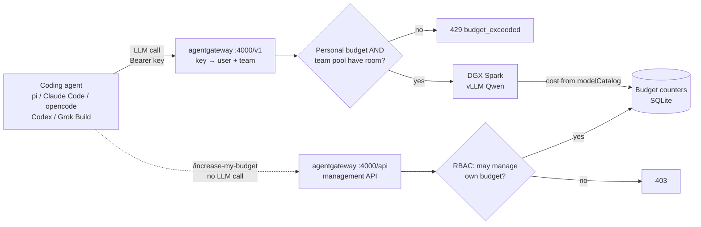

My [July post](/articles/2026-07-02-agentgateway-ai-budgets-hard-spend-limits/) covered hard spend limits on Kubernetes. This one starts from a question I keep getting from customers: *"We want one budget for the whole team, but we don't want one person burning through it in an afternoon. And when someone hits their limit at 4pm on a Friday, we don't want a ticket."*

So I built it: one shared **team pool**, a **personal limit** for each developer, and a command, `/increase-my-budget`, that lets a blocked developer borrow from the pool themselves. It works in five coding agents: pi, Claude Code, opencode, Codex CLI and Grok Build. **No agentgateway code was changed.** Everything except the borrow rule is native agentgateway Enterprise config.


*The red `429 budget_exceeded` lines at the start are the point, not a failed run: bob is over his personal limit, `/increase-my-budget` borrows from the team pool, and the same prompt then works.*

The code, configs and install steps for all five agents are at [github.com/sebbycorp/agentgateway-budget](https://github.com/sebbycorp/agentgateway-budget).

## What I wanted

- **One team pool** that everyone draws from. When it's empty, the whole team stops. That's the number finance cares about.
- **A personal limit** for each person, so one runaway agent loop can't drain the pool.
- A request goes through only while **both** have room.
- **Self-service borrowing:** a blocked developer can raise their own limit if the team still has money left, without asking an admin.
- **RBAC:** only the people I choose can borrow, and nobody can touch anyone else's budget or the pool itself.

## The lab

- **agentgateway Enterprise v2026.11.1**, standalone (single binary, no Kubernetes), in a Debian 13 LXC on my Proxmox box. Budget counters live in SQLite.
- **The model:** Qwen 3.8 Flash on my DGX Spark, served by vLLM. It's free to run, so I gave it a made-up price ($3 in, $15 out per million tokens) to make the dollar budgets mean something.
- **The agents:** pi in a second LXC, plus Claude Code, opencode, Codex and Grok Build on my Mac.
- **Test users:** alice, bob and carol on the engineering team; dave on research.

*Update, November 24:* I re-ran the pi flow with the gateway on my Mac instead of the LXC, on v2026.11.1-patch.0. The repo README now has a [laptop quick start](https://github.com/sebbycorp/agentgateway-budget#try-it-on-your-laptop-macos-apple-silicon), and that run added three entries to "Things that bit me" below.

## Architecture



There are two paths. Model calls go through the budget check. The borrow command goes to the **management API on the same port**, where RBAC decides whether this key may raise its own limit.

## Step 1: Budgets in standalone config

Standalone budgets match on **request attributes**. The API key carries the user and team in its metadata, and `standardAttributes` turns those into the `user` and `group` the budgets match on:

```yaml
config:
  database:
    url: sqlite:///var/lib/agentgateway/agw.db
  standardAttributes:
    user: 'apiKey.user'
    group: 'apiKey.group'
  modelCatalog:                    # price a self-hosted model
  - inline:
      providers:
        openai:
          models:
            qwen3.8-flash-next:
              rates: { input: "3.00", output: "15.00", cacheRead: "0.30" }

llm:
  policies:
    apiKey:
      mode: strict
      keys:
      - { key: sk-alice, metadata: { user: alice, group: engineering } }
      - { key: sk-bob,   metadata: { user: bob,   group: engineering } }
  budgets:
  - name: pool-engineering         # the team pool: a hard ceiling
    subject: { group: engineering }
    limit: { unit: USD, amount: 0.50 }
    window: { rolling: 24h }
    onBudgetExceeded: Block
  - name: user-alice               # a personal guardrail
    subject: { user: alice }
    limit: { unit: USD, amount: 0.10 }
    window: { rolling: 24h }
    onBudgetExceeded: Block
```

**Every matching budget applies.** alice's request matches both `user-alice` and `pool-engineering`, so it's blocked as soon as either one runs out. That one rule covers the whole "both must have room" requirement.

The custom price worked exactly: a call with 59 tokens in and 60 out was charged **$0.001077** (59 × $3/M + 60 × $15/M) to alice and the pool at once.

Two design choices took me a couple of tries:

- **One named budget per person, not a wildcard.** A `user: "*"` budget gives everyone their own counter. But you can't raise the limit for just one person, because every matching budget applies and a second budget can only make things stricter. Named budgets (`user-alice`) can be raised individually.
- **Raising a limit keeps the spend.** The counter's ID is built from the budget name and its subject, not its limit (`budget/mod.rs` in the source). Change only `amount`, and alice's $0.11 of spend stays put. Change `unit` or `window`, and it resets.

## Step 2: RBAC on the management API

Standalone agentgateway has a management API for its own config: `GET /api/budgets/usage` shows spend, and `PUT /api/config/resources/llm.budget/<name>` changes a budget, live. In file mode, agentgateway rewrites its own `config.yaml` and reloads it, with no restart.

The catch is in one line of the docs: **requests to the admin address are not restricted.** RBAC applies only when the UI and API are served on a gateway listener with authentication. So the admin port stays on localhost, and users get the API on port 4000, using the same key they use for the model:

```yaml
config:
  adminAddr: 127.0.0.1:15000       # bypasses RBAC, so keep it local

gateways:
  default: { port: 4000 }          # LLM routes and the UI/API on one port

ui:
  policies:
    apiKey:
      keys:
      - { key: sk-alice, metadata: { user: alice, group: engineering } }
      - { key: sk-carol, metadata: { user: carol, group: engineering } }

rbac:
  mode: fine-grained
  policies:
  - name: engineering-borrowers
    subjects: [{ user: alice }, { user: bob }]
    grants:
    - { resource: llm.budget, access: view,   scope: { names: [pool-engineering] } }
    - { resource: llm.budget, access: view,   scope: { owner: self } }
    - { resource: llm.budget, access: manage, scope: { owner: self } }
  - name: engineering-viewers
    subjects: [{ user: carol }]
    grants:
    - { resource: llm.budget, access: view, scope: { names: [pool-engineering] } }
    - { resource: llm.budget, access: view, scope: { owner: self } }
```

`owner: self` on a budget means **the budget's `subject.user` is the caller**. alice can manage `user-alice` and nothing else. The team pool has no `user`, so nobody owns it, and only an admin can resize it. Team members get `view` on the pool by name, so they can see what's left.

The test script checks all of it, with no model calls:


## Step 3: The borrow rule

This is the only logic that isn't agentgateway config: about 60 lines of bash, curl and jq ([`bin/increase-my-budget`](https://github.com/sebbycorp/agentgateway-budget/blob/main/bin/increase-my-budget)). With your own key, it:

1. **Reads `/api/budgets/usage`.** RBAC filters the result to your budget and your team pool, so the script works out who you are from what it can see. Nobody types a user name, so nobody can act as someone else.
2. **Applies the rule:** the team has at least $0.10 left, you've used at least 80% of your limit, and the new limit is your old one plus $0.10, capped at $0.50 and at what the pool has left.
3. **Sends `PUT /api/config/resources/llm.budget/user-<you>`** with the new amount. agentgateway checks RBAC (200 or 403), rewrites its config and reloads. The new limit applies within a few seconds.

```text
user=bob used=$0.165135 limit=$0.2 | team engineering left=$0.229199
RAISED: user-bob $0.2 -> $0.30 (spend so far $0.165135 is kept; applies in ~5s)
```

Even if someone skips the script and calls the API directly, the team pool still blocks at the gateway, so **the team can never overspend.**

## Step 4: The command in every coding agent

The important requirement: **the command must not call the model.** A blocked user's model calls return 429, so a command that goes through the model fails exactly when it's needed, and it costs money while it does. Each agent needed a different way to run code without a model turn:

| Agent | How `/my-budget` and `/increase-my-budget` are wired | Typed as |
|---|---|---|
| pi | Native extension command (`pi.registerCommand`) | `/my-budget` |
| Claude Code | Plugin with a `UserPromptSubmit` hook that blocks the prompt | `/my-budget` |
| opencode | TUI plugin, registered as a palette slash command | `/my-budget` |
| Codex CLI | `UserPromptSubmit` hook | `my-budget` (no slash) |
| Grok Build | Global `UserPromptSubmit` hook, plus a skill for autocomplete | `/my-budget` |

### pi

pi's extensions can register real slash commands that run JavaScript, so this was the easiest one:


| Blocked by the gateway | `/increase-my-budget` | Next prompt works |
|---|---|---|
|  |  |  |

### Claude Code

Claude Code's slash-command files are prompts, so they call the model. A **`UserPromptSubmit` hook** can intercept the prompt instead: it runs the script and returns `{"decision":"block","reason":"…"}`. You see the output, and the model never gets the prompt. It's packaged as a plugin with a marketplace file, so installing it is two commands:

```text
/plugin marketplace add sebbycorp/agentgateway-budget
/plugin install agentgateway-budget@agentgateway-budget
```


### opencode

opencode 1.19's TUI plugin API registers commands that show up in the `/` palette and run locally. The result appears in a dialog, with no session and no model call:


### Codex CLI

Codex 0.170 has Claude Code-style hooks, but its TUI rejects unknown `/commands` before any hook runs. So in Codex you type `my-budget` without the slash. Codex also asks you to trust the hook once:

| One-time hook trust | `my-budget` and `increase-my-budget` |
|---|---|
|  |  |

### Grok Build

Grok Build supports the same hook format. Two skills marked `disable-model-invocation` put the commands in the `/` menu, and the hook catches them before the model sees them:

| `/` menu | `/my-budget` |
|---|---|
|  |  |

## What I tried first and threw away

- **A Python broker next to the gateway.** My first version had a small service that read usage, decided, and re-rendered the config from a template. It worked, but it was one more process to run. Once I found the management API and its RBAC, the broker's whole job became a single `PUT`.
- **A "tier" attribute** (`standard` vs `boost`) that moved a user to a bigger budget. Switching tiers started a fresh counter, so a boosted user actually got the standard limit *plus* the boost limit. Raising a named budget, which keeps the spend, is the honest version.
- **A pi prompt template** for the command. The model refused to run it ("this exposes a secret to an unknown program"), and the agent turn was charged to the budget. That's what pushed me to native commands and hooks everywhere.

## Results

| Scenario | Result |
|---|---|
| alice uses pi until her budget runs out | Blocked on turn 14 with `429 budget_exceeded` |
| alice runs `/increase-my-budget` while blocked | $0.20 → $0.30, spend kept, pi works again |
| bob borrows with no spend | Denied by the 80% rule |
| carol (viewer) borrows | `403` from RBAC |
| alice tries to raise bob's budget or the pool | `403` |
| The team pool runs out | bob blocked even with $0.098 of personal budget left |
| The research pool while engineering is empty | dave unaffected |

I also ran the agentgateway repo's own test suite against the release: 4,584 passed, all 130 budget tests passed, and one flaky connection-pool test failed and passed 5/5 when run alone.

## Things that bit me

- **The Enterprise Linux binary needs glibc 2.39.** Debian 12 LXC templates ship 2.36. Use Debian 13 or Ubuntu 24.04.
- **The admin port skips RBAC.** If you expose `adminAddr` on your LAN, anyone there can rewrite any budget. Bind it to `127.0.0.1` and serve the API on a gateway listener.
- **Raises take a few seconds to apply.** The `PUT` returns when the file is written; the new limit is enforced after the reload. My first test retried instantly and saw the old limit.
- **Last request overshoots.** Budgets are checked before a request and charged after it, so alice ended at $0.114 against $0.10.
- **Windows align to UTC.** A `24h` budget resets at midnight UTC, which is 7pm in Toronto. My counters all reset in the middle of testing.
- **Codex rejects unknown slash commands** before hooks run, so its users type `my-budget` without the slash.
- **Quote `${CLAUDE_PLUGIN_ROOT}`** in plugin hooks. My Google Drive path has spaces, and the hook failed silently until I quoted it.
- **Grok Build retries a 429 up to 9 times** by default. Set `max_retries = 1` in the model config so over-budget users don't hammer the gateway.
- **Claude Code needs a Claude model behind the gateway.** agentgateway translated Claude Code's requests to my Qwen backend fine, but Qwen's chat template rejected Claude Code's system prompt layout. The hook commands still worked, because they never reach the model.
- **macOS still ships bash 3.2,** where `set -u` treats an empty array as unset. That broke every borrow in one test run until I fixed it.
- **A stray `OPENAI_API_KEY` wins the key lookup.** The script tries `AGW_KEY`, `AGW_API_KEY`, `ANTHROPIC_AUTH_TOKEN` and `OPENAI_API_KEY` before pi's provider key. My Mac exports a real OpenAI key, so `/my-budget` sent that to the gateway and got a 401. The pi extension now passes the `agw-ent` key from `models.json` itself. In the other agents, set `AGW_KEY`.
- **The license variable is `ENTERPRISE_AGENTGATEWAY_LICENSE_KEY`.** I had `AGENTGATEWAY_LICENSE_KEY` exported, which the standalone binary doesn't read.
- **Old pi hangs on a blocked prompt.** On pi 0.73, a prompt sent while over budget sat silent in `pi -p` instead of printing the 429. The gateway's 429 carries a `retry-after` of several hours (until the window resets), which may be why. The commands themselves worked. pi moved to the `@earendil-works/pi-coding-agent` package; 1.5 prints the errors as in the screenshots above.

## Wrap-up

The split ended up clean. **agentgateway does everything that has to be enforced:** the team pool, the personal limits, the pricing, the 429s and who may change what. The only thing outside the gateway is *when* a raise is allowed, and that's 60 lines of bash wrapped in whatever hook or extension each agent offers.

RBAC controls **who** can change **which** budget, not **by how much**. An allowed borrower could call the API directly with any amount. The team pool still caps the damage. If you want the amount enforced on the server too, take `manage` away from users and have admins raise limits. Two things I'd love to see natively are an "overflow to the team pool" option on a budget and a cap on self-service raises in the RBAC grant.

Everything is at [github.com/sebbycorp/agentgateway-budget](https://github.com/sebbycorp/agentgateway-budget): the script, the plugins and hooks for all five agents, an example gateway config and the RBAC test.
