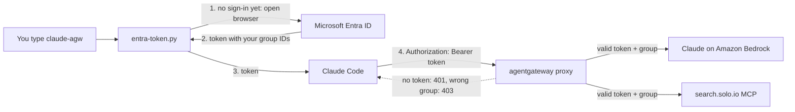

Earlier today I put [Entra ID sign-in in front of Codex CLI](/articles/2026-11-19-codex-cli-entra-id-sign-in-agentgateway/). The obvious next question was whether Claude Code can do the same thing against the same gateway. It can, and the result is simpler than the Codex one.

When I type `claude-agw` now, I get the Microsoft sign-in page if I have no valid sign-in, and then Claude Code starts. It talks to Claude Sonnet 5.5 on Amazon Bedrock through agentgateway. Claude Code has no API key and no Anthropic login. The gateway only lets me in with an Entra ID token **and** membership of one group.


What you end up with:

- **A separate Claude Code profile.** Everything lives in `~/.claude-agentgateway`. Plain `claude` still uses your normal `~/.claude` and your normal account.
- **Claude on Bedrock, no key on the laptop.** The gateway holds the Bedrock API key. Claude Code sends the Anthropic Messages API and the gateway translates it.
- **Entra sign-in with a group check.** No token is a 401. A valid token without the group is a 403.
- **One sign-in for the model and the MCP server.** This is the part that is easier than Codex.
- **Logs with a name on them.** Each call in the agentgateway UI shows who sent it.

All of it is open source agentgateway v1.7.0 and Claude Code 2.1.328, configured by hand. Every command is in the repo: [sebbycorp/agentgateway-oss-k8s, claude-code/README.md](https://github.com/sebbycorp/agentgateway-oss-k8s/blob/main/claude-code/README.md).

## How it fits together



Claude Code has no built-in "sign in to my gateway" flow like Codex does. It has something more general: a setting called `apiKeyHelper`. You point it at a program, and Claude Code sends whatever that program prints as the bearer token. So the sign-in lives in a small helper, and Claude Code just asks it for a token.

| Part | What it does |
|---|---|
| Entra app registration | Issues tokens for "the gateway", with the user's group IDs inside |
| agentgateway policy | Checks the token's signature, issuer, audience and group |
| `entra-token.py` | Signs you in with the browser, stores and refreshes the token |
| Claude Code profile | Points Claude Code at the gateway and at the helper |

## What you need

- The gateway from the repo's [main README](https://github.com/sebbycorp/agentgateway-oss-k8s#readme), Steps 1 to 10: a kind cluster with agentgateway on `localhost:8080`, the `bedrock-secret`, and the `solo-search` MCP route.
- The Entra group and app registration from [Steps 1 and 2 of the Codex post](/articles/2026-11-19-codex-cli-entra-id-sign-in-agentgateway/#step-1-create-the-group). Claude Code uses the same ones. Nothing extra has to be registered.
- Claude Code, `jq`, Python 3 and `curl`.

```sh
export CTX=kind-agentgateway-codex
export TENANT_ID=... APP_ID=... GROUP_ID=...     # from the Entra steps
```

## Step 1: Publish the Claude models

Claude Code asks for models by their Anthropic names, such as `claude-sonnet-5-5`. So I published the Bedrock models under exactly those names. Each one is an `AgentgatewayModel` with a one-line rewrite to the Bedrock ID:

```yaml
apiVersion: agentgateway.dev/v1alpha1
kind: AgentgatewayModel
metadata:
  name: claude-sonnet-5-5            # the name Claude Code sends
  namespace: agentgateway-system
spec:
  parentRefs:
  - group: gateway.networking.k8s.io
    kind: Gateway
    name: agentgateway-proxy
    sectionName: http
  provider: Bedrock
  bedrock:
    region: us-east-2
  policies:
    auth:
      secretRef:
        name: bedrock-secret         # Bedrock API key, held by the gateway
    transformations:
    - field: model
      expression: '"us.anthropic.claude-sonnet-5-5"'   # what Bedrock receives
```

[`k8s/08-claude-code-models.yaml`](https://github.com/sebbycorp/agentgateway-oss-k8s/blob/main/k8s/08-claude-code-models.yaml) has three of these: Opus, Sonnet and Haiku 5.5.

```sh
kubectl --context $CTX apply -f k8s/08-claude-code-models.yaml
```

That is the whole gateway change for Claude Code. An `AgentgatewayModel` already accepts the Anthropic Messages API on `/v1/messages`. I did not add a route or a backend.

## Step 2: Create the Claude Code profile

Claude Code has no named profiles. What it has is `CLAUDE_CONFIG_DIR`: point it at another directory and you get separate settings, history, MCP servers and credentials.

```sh
P=$HOME/.claude-agentgateway
mkdir -p $P

cat > $P/settings.json <<'EOF'
{
  "env": {
    "ANTHROPIC_BASE_URL": "http://localhost:8080",
    "ANTHROPIC_AUTH_TOKEN": "none-the-gateway-holds-the-key",
    "ANTHROPIC_MODEL": "claude-sonnet-5-5",
    "ANTHROPIC_DEFAULT_OPUS_MODEL": "claude-opus-5-5",
    "ANTHROPIC_DEFAULT_SONNET_MODEL": "claude-sonnet-5-5",
    "ANTHROPIC_DEFAULT_HAIKU_MODEL": "claude-haiku-5-5",
    "CLAUDE_CODE_ENABLE_GATEWAY_MODEL_DISCOVERY": "1",
    "CLAUDE_CODE_DISABLE_NONESSENTIAL_TRAFFIC": "1"
  }
}
EOF

CLAUDE_CONFIG_DIR=$P claude mcp add --transport http --scope user solo-search http://localhost:8080/mcp
```

What the settings do:

| Setting | Why |
|---|---|
| `ANTHROPIC_BASE_URL` | The gateway. No `/v1` on the end; Claude Code adds `/v1/messages` itself |
| `ANTHROPIC_AUTH_TOKEN` | A placeholder. Without some value Claude Code shows its login screen. The gateway ignores it |
| `ANTHROPIC_DEFAULT_*_MODEL` | Pins what `opus`, `sonnet` and `haiku` mean, so they always match what the gateway publishes |
| `CLAUDE_CODE_ENABLE_GATEWAY_MODEL_DISCOVERY` | Makes `/model` list what the gateway serves |
| `CLAUDE_CODE_DISABLE_NONESSENTIAL_TRAFFIC` | Turns off telemetry and update checks that would go to Anthropic directly |

At this point it already works without Entra. I checked before going further:

```sh
CLAUDE_CONFIG_DIR=$P claude -p "Reply with exactly: hello from agentgateway"
# hello from agentgateway
```

The gateway log showed the call going to Bedrock, with prompt caching working:

```
http.path=/v1/messages?beta=true http.status=200 protocol=llm gen_ai.provider.name=aws.bedrock
gen_ai.request.model=us.anthropic.claude-sonnet-5-5 agw.ai.original_model=claude-sonnet-5-5
gen_ai.usage.cache_read.input_tokens=13569
```

## Step 3: Turn on Entra at the gateway

Same two policies as in the Codex post, from [`k8s/06-entra-auth.yaml`](https://github.com/sebbycorp/agentgateway-oss-k8s/blob/main/k8s/06-entra-auth.yaml): one on the Gateway for everything, one on the MCP route.

```sh
sed -e "s/\${TENANT_ID}/$TENANT_ID/g" -e "s/\${APP_ID}/$APP_ID/g" -e "s/\${GROUP_ID}/$GROUP_ID/g" \
  k8s/06-entra-auth.yaml | kubectl --context $CTX apply -f -

# show the sign-in name in the request logs instead of an opaque ID
kubectl --context $CTX -n agentgateway-system patch agentgatewayparameters agentgateway-proxy-params \
  --type merge -p '{"spec":{"rawConfig":{"config":{"standardAttributes":{"user":"jwt.preferred_username"}}}}}'
```

I tested the gateway with curl before touching Claude Code, on `/v1/messages`:

| Request | Result |
|---|---|
| No token | 401 |
| Entra token in `Authorization: Bearer` | 200 |
| Entra token in `Authorization: Bearer` and in `x-api-key` | 200 |
| Entra token in `x-api-key` only | 401 |

The last two rows matter for the next step. The policy reads the `Authorization` header and nothing else.

## Step 4: Give Claude Code a way to get a token

[`entra-token.py`](https://github.com/sebbycorp/agentgateway-oss-k8s/blob/main/claude-code/entra-token.py) is about 140 lines of Python with no dependencies. It does a browser sign-in with PKCE against the app registration (a public client, so there is no secret), keeps the access and refresh token in a file only I can read, and refreshes the access token when less than 10 minutes are left.

| Command | What it does |
|---|---|
| `entra-token.py` | Prints a valid access token. This is what Claude Code calls |
| `entra-token.py headers` | Prints `{"Authorization": "Bearer ..."}` for the MCP server |
| `entra-token.py ensure` | Opens the sign-in page only if there is no usable sign-in |
| `entra-token.py login` / `logout` | Sign in again, or forget the sign-in |

Install it into the profile and switch the profile over:

```sh
P=$HOME/.claude-agentgateway

# 1. The helper and the IDs it needs (neither ID is a secret)
install -m 755 claude-code/entra-token.py $P/entra-token.py
echo "{\"tenantId\": \"$TENANT_ID\", \"appId\": \"$APP_ID\"}" > $P/entra.json

# 2. Settings: drop the placeholder token, run the helper instead
jq --arg helper "$P/entra-token.py" 'del(.env.ANTHROPIC_AUTH_TOKEN) | .apiKeyHelper = $helper' \
  $P/settings.json > $P/settings.json.new && mv $P/settings.json.new $P/settings.json

# 3. MCP server: send the same token
CLAUDE_CONFIG_DIR=$P claude mcp remove --scope user solo-search
CLAUDE_CONFIG_DIR=$P claude mcp add-json --scope user solo-search \
  "{\"type\": \"http\", \"url\": \"http://localhost:8080/mcp\", \"headersHelper\": \"$P/entra-token.py headers\"}"
```

Two Claude Code settings do the work:

- **`apiKeyHelper`** in `settings.json`. Claude Code runs it, and sends the output as both `Authorization: Bearer` and `x-api-key`. The gateway reads the first and ignores the second, which is why I tested that combination in Step 3. Claude Code asks the helper again every 5 minutes and after a 401.
- **`headersHelper`** on the MCP server. Claude Code runs it and adds the headers it prints to every MCP request.

You have to remove `ANTHROPIC_AUTH_TOKEN` when you add `apiKeyHelper`. The token outranks the helper, so if both are set the helper is never called and the gateway answers 401.

## Step 5: One alias, one sign-in

```sh
echo "alias claude-agw='\$HOME/.claude-agentgateway/entra-token.py ensure && CLAUDE_CONFIG_DIR=\$HOME/.claude-agentgateway claude'" >> ~/.zshrc
source ~/.zshrc

claude-agw
```

The first run opens the Microsoft page. After the sign-in, Claude Code starts. Later runs go straight in, because the helper refreshes the token on its own.

The first interactive start of a new profile asks for a colour theme. It does not ask for an Anthropic login.

Then the full test, model plus shell tool plus MCP tool:

```sh
claude-agw -p "Use the solo-search MCP search tool to look up: AgentgatewayModel, and run 'echo ok' in the shell." \
  --allowedTools "mcp__solo-search__search,Bash(echo:*)"
```

The gateway log showed the three model calls and the MCP `tools/call`, all with status 200. And the request log has my sign-in name on each call (blurred here, with the group):


## Why this is simpler than Codex

With Codex the MCP server had its own sign-in, and that was the part that took the longest. Codex adds an ID to its MCP callback path, Entra matches redirect paths exactly, and so I had to find that ID and register it on the app. It also changes whenever the gateway address changes.

With Claude Code the MCP server does not sign in at all. `headersHelper` hands it the token the model already uses. So:

| | Codex CLI | Claude Code |
|---|---|---|
| Sign-in for the model | Built in (`gateway_oauth`) | `apiKeyHelper` runs a helper |
| Sign-in for the MCP server | A second, separate sign-in | Same token, through `headersHelper` |
| Extra redirect URI in Entra | Yes, one per MCP server URL | No |
| Extra file to maintain | No | Yes, the helper |

The trade is one small helper file for one less sign-in and no callback registration.

## Things that caught me

- **The helper cannot open a browser.** Claude Code runs `apiKeyHelper` in the background, so a sign-in page from there would appear out of nowhere, or time out. The helper never opens a browser when Claude Code calls it. The alias runs `entra-token.py ensure` first, and that is the only place the sign-in page comes from.
- **Python could not verify Microsoft's certificate.** My first version made the token request with Python's `urllib`. The browser sign-in worked, then the token exchange failed with `CERTIFICATE_VERIFY_FAILED`, because the python.org install on my Mac has no CA certificates. I changed that one call to `curl`, which uses the system certificate store. The form body goes over stdin, so the code and the refresh token are not on a command line.
- **The gateway port has to be fixed.** I used to run cloud-provider-kind with a random localhost port, and every Docker restart broke the URL in the profile. The cluster now maps `localhost:8080` to a NodePort in the kind config. It also listens on `127.0.0.1` only.
- **The token file is a plain file.** `~/.claude-agentgateway/entra-token.json` holds the refresh token with `0600` permissions. It is not in the macOS Keychain.
- **A sign-in can expire in the middle of a session.** If the refresh token is revoked, calls fail with `Not signed in to Entra ID`. Run `~/.claude-agentgateway/entra-token.py login` in another terminal and the session continues.
- **Token counting returns 403.** My Bedrock API key's IAM user is not allowed `bedrock:CountTokens`. Claude Code falls back to an estimate, so nothing breaks.
- **Not every Claude model was available.** Opus, Sonnet and Haiku 5.5 worked. Fable 5.2 on my account answered `data retention mode 'default' is not available for this model`, so I did not publish it.
- **The OpenAI models on the same gateway do not work from Claude Code.** `--model gpt-oss-120b` fails, because Bedrock rejects Claude Code's prompt-cache markers and its thinking setting for those models. I use Codex for them.
- **Group changes are slow.** Membership is read when the token is issued, so removing someone from the group takes up to an hour to bite.
- **It is still plain HTTP on localhost.** The token is a bearer credential. Put TLS on the listener before you use this off your own machine.

One thing I did not try: pointing `apiKeyHelper` straight at `az account get-access-token`. That would need no helper file, but it reuses the Azure CLI session and never shows a sign-in page, which is the behaviour I wanted to get away from in the Codex post.

## Where to go next

The repo has this as a step-by-step guide with every command: [claude-code/README.md](https://github.com/sebbycorp/agentgateway-oss-k8s/blob/main/claude-code/README.md). The gateway build is in the [main README](https://github.com/sebbycorp/agentgateway-oss-k8s#readme), and the Codex side is in [codex/README.md](https://github.com/sebbycorp/agentgateway-oss-k8s/blob/main/codex/README.md).

Related posts:

- [Add Entra ID sign-in to Codex CLI through agentgateway](/articles/2026-11-19-codex-cli-entra-id-sign-in-agentgateway/), the same gateway policies with Codex as the client
- [Deploy Codex CLI with Bedrock through agentgateway](/articles/2026-11-18-deploy-codex-cli-bedrock-agentgateway/), the gateway build these posts start from
- [Claude Code on Amazon Bedrock with short-lived credentials](/articles/2026-10-30-claude-code-bedrock-agentdesktop-agentgateway/), for another take on Claude Code authentication
