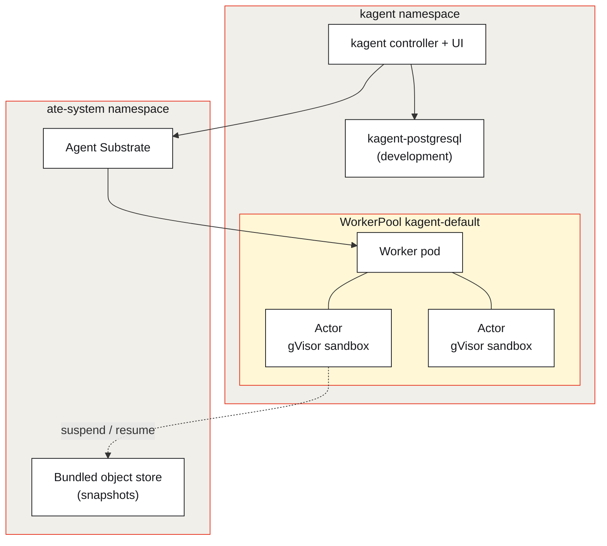

**By Sebastian Maniak**

kagent 1.0 changed what an install is. Every agent now runs on **Agent Substrate**, so you get two systems in one cluster: Substrate, which provides the sandboxed compute, and kagent, which provides the agents you build on top of it.

The good news is that you install both with **one command**. The part people skip is what comes after: knowing what that command created, how to tell that it's healthy, and what to change before real work depends on it.

This guide does both. The first half gets you running. The second half is how to manage Substrate properly. The install steps follow the [Install kagent](https://kagent.dev/docs/kagent/latest/setup/) page in the kagent docs.


*From the kagent docs: installing kagent on a local kind cluster with the CLI, sped up.*

> A note on speed. You type the commands in seconds. The install itself takes a few minutes, because it pulls images and waits for each component to be ready.

---

## The short version

If you only want it running, this is everything:

```bash
kind create cluster --name kagent --image kindest/node:v1.37.0
export OPENAI_API_KEY="your-api-key-here"
curl -sL https://kagent.dev/install | bash && kagent install
kagent dashboard
```

The rest of this post explains each step and what to do next.

## Part 1: Install

### Step 1: Install the tools

You need three tools on your machine:

- [`kubectl`](https://kubernetes.io/docs/tasks/tools/#kubectl), the Kubernetes command line tool.
- [`helm`](https://helm.sh/docs/intro/install/) 3. The kagent CLI runs `helm` to install each chart.
- [`kind`](https://kind.sigs.k8s.io/docs/user/quick-start/#installation) **v0.32.0 or later**, only if you're creating a local cluster.

### Step 2: Get a cluster at Kubernetes 1.37 or later

This is the requirement that catches people. Agent Substrate depends on the `PodCertificateRequest` and `ClusterTrustBundle` APIs, and both are generally available in **Kubernetes 1.37**. An older cluster won't work.

**For a local cluster**, create one with kind:

```bash
kind create cluster --name kagent --image kindest/node:v1.37.0
```

**For an existing cluster**, confirm that it serves the APIs:

```bash
kubectl api-resources --api-group=certificates.k8s.io
```

You should see `clustertrustbundles` and `podcertificaterequests` in the list, both at `certificates.k8s.io/v1`:

```console
NAME                           SHORTNAMES   APIVERSION               NAMESPACED   KIND
certificatesigningrequests     csr          certificates.k8s.io/v1   false        CertificateSigningRequest
clustertrustbundles                         certificates.k8s.io/v1   false        ClusterTrustBundle
podcertificaterequests                      certificates.k8s.io/v1   true         PodCertificateRequest
```

### Step 3: Set your model provider's API key

The installer reads the key from an environment variable. Set the one for your provider:

| Provider | Variable |
|---|---|
| OpenAI | `export OPENAI_API_KEY="your-api-key-here"` |
| Anthropic | `export ANTHROPIC_API_KEY="your-api-key-here"` |
| Gemini | `export GOOGLE_API_KEY="your-api-key-here"` |
| Ollama Cloud | `export OLLAMA_API_KEY="your-api-key-here"` |

### Step 4: Install kagent

Run the command for your provider. The first half downloads the `kagent` CLI. The second half installs everything into your cluster.

| Provider | Command |
|---|---|
| OpenAI | `curl -sL https://kagent.dev/install \| bash && kagent install` |
| Anthropic | `curl -sL https://kagent.dev/install \| bash && kagent install --provider Anthropic` |
| Gemini | `curl -sL https://kagent.dev/install \| bash && kagent install --provider Gemini` |
| Ollama | `curl -sL https://kagent.dev/install \| bash && kagent install --provider Ollama` |

Two things that can trip you up here:

- **The password prompt.** The script puts the CLI in `/usr/local/bin` and asks for your password to write there. To install into `$HOME/bin` without `sudo`, run the script with `bash -s -- --no-sudo`.
- **An older `kagent` on your path.** Your shell can keep running the old one, and `kagent install` then installs the older release. Run `kagent version` and check that `kagent_version` is the release the script downloaded.

To pin a specific release, pass `--version` to the script:

```bash
curl -sL https://kagent.dev/install | bash -s -- --version v1.0.1
```

### Step 5: Open the dashboard

```bash
kagent dashboard
```

This forwards the UI to `http://localhost:8082`. On macOS it also opens your browser. On Linux and Windows, open the address yourself, or port-forward the UI service:

```bash
kubectl port-forward -n kagent svc/kagent-ui 8082:8080
```


*From the kagent docs: the dashboard after a fresh installation. No agents yet, one model configuration, two MCP servers and the tools kagent discovered on them.*

That's the install. You can go build an agent now. I'd read the next part first.

## Part 2: Know what you installed

`kagent install` sets up the components in order: the CRDs, Agent Substrate, a development PostgreSQL database, and then kagent.

| What | Where | What it's for |
|---|---|---|
| Agent Substrate | `ate-system` namespace | The sandboxed compute that agents run on |
| PodCertificate controller | `podcertificate-controller-system` namespace | Issues the certificates Substrate uses for identity |
| kagent controller, UI and tools server | `kagent` namespace | The API, the dashboard and the built-in Kubernetes MCP server |
| `kagent-postgresql` | `kagent` namespace | A development database for kagent and Substrate |
| `kagent-default` WorkerPool | `kagent` namespace | The pool of gVisor Workers that host your agents |
| `kagent-default`, `codex-default`, `claude-default` Harnesses | `kagent` namespace | Ready-made runtimes an agent can reference |

A few words that come up for the rest of this post:

- A **Worker** is a pod that Substrate starts in advance. Agents run on Workers that are already running, so nothing waits for a new pod.
- A **WorkerPool** is the Kubernetes resource that says how many Workers to keep and which sandbox they use.
- An **Actor** is one sandboxed agent session. One Worker hosts many Actors.
- A **snapshot** is an Actor written to object storage. Substrate suspends an idle Actor to a snapshot and resumes it when the next message arrives.



## Part 3: Check that it's healthy

Run these three checks after every install, before you create an agent.

### Check 1: The pods

```bash
kubectl get pods -n kagent
```

Every pod should report `Running`. The docs show this for a CLI install:

```console
NAME                                              READY   STATUS    RESTARTS   AGE
kagent-controller-56c67b6cd7-hqj5z                1/1     Running   3          2m
kagent-default-774d4496bd-sfx4b                   1/1     Running   0          2m
kagent-postgresql-856b475f59-n258n                2/2     Running   0          2m
kagent-tools-54959b659c-lfkrz                     1/1     Running   0          2m
kagent-ui-5fdb6fd85c-vzb2z                        1/1     Running   0          2m
```

The `kagent-default` pod is your Worker.

### Check 2: The worker pool

```bash
kubectl get workerpools -n kagent
```

```console
NAME             DESIRED   REPLICAS   READY   SANDBOXCONFIG    RESOLVED   AGE
kagent-default   1         1          1       gvisor-default   True       2m
```

Read the three counts together:

- `DESIRED` is how many Workers you asked for.
- `REPLICAS` is how many Worker pods exist.
- `READY` is how many are serving.

If `DESIRED` and `REPLICAS` differ, the controller isn't creating pods. If `REPLICAS` and `READY` differ, the pods exist but aren't starting. `RESOLVED` should be `True`, which means the pool found the gVisor runtime files it needs.

### Check 3: The harnesses

```bash
kubectl get harnesses -n kagent
```

You should see `kagent-default`, `codex-default` and `claude-default`.

## Part 4: Read the Substrate page

The UI has a page for this. In the sidebar, click **Substrate**.


*From the kagent docs: the Substrate page on a fresh installation.*

Read it from the tiles at the top:

| Tile | What it means |
|---|---|
| **Worker pools** | The pools that exist. An agent can't run until there's at least one. |
| **Templates ready** | ActorTemplates that are compiled and ready. kagent creates one for each agent revision. |
| **Actors running** | Live Actors. Each one is running one session. |
| **Workers busy** | Workers assigned to an Actor, against the total. |

On a fresh install you see one worker pool, `0/0` templates, `0/0` actors and **Workers busy** at `0/1`. That's correct. No agent exists yet, and the one idle Worker is your capacity, waiting.

Once you have agents, this page is the fastest way to answer "is anything running right now?" Most of the time the answer is no, and that's how Substrate is meant to work. Idle sessions are suspended, not running.

## Part 5: Inspect it from the command line

For more detail than the UI gives, the controller has a `SystemService` API. You need [grpcurl](https://github.com/fullstorydev/grpcurl) and [jq](https://jqlang.org/download/). `kubectl` and the `kagent` CLI don't expose these calls.

Port-forward the controller and leave it running in a second terminal:

```bash
kubectl port-forward -n kagent svc/kagent-controller 8083:8083
```

**Get a summary** of pools and Actors by state:

```bash
grpcurl -plaintext -d '{"namespace":"kagent","atespace":"kagent"}' \
  localhost:8083 kagent.api.v1.SystemService/GetSubstrateSummary \
  | jq '{workerPools: [.workerPools[].resource.value | {name: .metadata.name, workerImage: .spec.workerImage, readyReplicas: .status.readyReplicas}], actorCount, workerCount, actorStatusCounts}'
```

The docs show output like this, for a cluster with three sessions:

```json
{
  "workerPools": [
    {
      "name": "kagent-default",
      "workerImage": "ghcr.io/kagent-dev/substrate/ateworker-gvisor:v1.0.0",
      "readyReplicas": 1
    }
  ],
  "actorCount": "3",
  "workerCount": "1",
  "actorStatusCounts": [
    { "count": "1", "state": "ACTOR_STATE_RUNNING" },
    { "count": "2", "state": "ACTOR_STATE_SUSPENDED" }
  ]
}
```

Three Actors, one running. The two suspended ones don't occupy a Worker.

**List the Actors** with their latest snapshot:

```bash
grpcurl -plaintext -d '{"atespace":"kagent"}' \
  localhost:8083 kagent.api.v1.SystemService/ListSubstrateActors \
  | jq '.actors[] | {name: .metadata.name, state: .status.state, snapshotUri: .status.snapshots[-1].durableSnapshot.object.snapshotUri}'
```

Each Actor is named `session-` followed by the session's ID. The **atespace** in the request is Substrate's own isolation boundary. kagent names it after the Kubernetes namespace of the agent, so for agents in `kagent` it's `kagent`.

**List the Workers** and their capacity:

```bash
grpcurl -plaintext -d '{"namespace":"kagent"}' \
  localhost:8083 kagent.api.v1.SystemService/ListSubstrateWorkers \
  | jq '.workers[] | {workerPod, nodeName, state: .status.state, capacity: .status.capacity}'
```

Look at `capacity.actors` in the result. The gVisor Worker reports a capacity of **1000 Actors**.

## Part 6: Manage it the right way

This is the part that matters once people depend on the cluster.

### Size the pool for concurrent turns, not for agents

The replica count is the only capacity setting on a pool. The mistake is to size it by counting agents or sessions.

A Worker runs an Actor only while a turn is running. kagent suspends the Actor at every turn boundary and frees its share of the Worker. An idle session uses no Worker capacity. So the number that matters is **how many turns run at the same time**. A cluster with hundreds of sessions that are each used now and then needs far fewer Workers than the session count suggests.

Scale a pool in place:

```bash
kubectl scale workerpool kagent-default -n kagent --replicas=3
```

Or set it in your Helm values so it survives an upgrade:

```yaml
substrateWorkerPool:
  replicas: 3
```

The WorkerPool has a scale subresource, so a HorizontalPodAutoscaler can size it from a metric too.

### Learn what an undersized pool looks like

This one is worth knowing in advance, because the error doesn't say what's wrong. A turn that can't get a Worker waits for one. If it waits too long, it fails with a generic timeout:

```console
ERROR:
  Code: Internal
  Message: actor "ai-01a087c0-1d72-775a-9a32-566acac7b685" request timed out
```

Nothing in that message mentions capacity or the pool, and the controller log doesn't either. What you see in practice is **intermittent timeouts when several agents run at once**. If that's your symptom, check the pool's `READY` count and Substrate's metrics for Workers at `at_capacity` and placements with a `no_capacity` outcome. If the pool is under pressure, raise the replica count.

### Set resource requests and limits on Workers

Worker pods have no resource requests or limits unless you set them. A Worker with no limits reports its node's whole capacity as its own. Every Worker on that node reports the same figures, so Kubernetes can't stop too many Workers from landing on one node.

Set them on any pool that serves real traffic:

```yaml
substrateWorkerPool:
  template:
    resources:
      requests:
        cpu: 500m
        memory: 1Gi
      limits:
        cpu: "2"
        memory: 4Gi
```

The same `template` block takes `nodeSelector`, `tolerations`, `priorityClassName` and `nodeAffinity`, so you can keep Workers on nodes you set aside for them.

### Move snapshots off the bundled object store

Every suspended Actor is written to object storage. That bucket holds the state your sessions resume from.

The default install uses an object store bundled with the Substrate chart. It's fine for a kind cluster, and it's wrong for production, for two reasons from the docs:

- **It isn't durable.** It's an in-cluster store on a 1Gi PersistentVolumeClaim.
- **Every installation gets the same credentials for it.** The chart sets the access key and secret key to published defaults.

Before real traffic, move snapshots to your own Google Cloud Storage or S3 bucket. Each Harness names where its Actors write, in `spec.substrate.snapshotPolicy.location`. The steps are in [Move snapshots to an external bucket](https://kagent.dev/docs/kagent/latest/operations/tune-agent-substrate#move-snapshots-to-an-external-bucket).

### Replace the development database

The CLI install deploys `kagent-postgresql`, a stock `postgres` image meant for evaluation. Two things to know:

- It doesn't include the `pgvector` extension, which long-term agent memory needs.
- It holds your conversations and your schedules. Schedules aren't Kubernetes resources, so GitOps can't restore them.

For anything you care about, install with Helm against your own PostgreSQL database. The docs cover that in [Advanced Install](https://kagent.dev/docs/kagent/latest/setup/installation/).

### Know the three kagent 1.0 upgrade facts

- **There's no in-place upgrade from 0.10.x.** kagent 1.0 installs fresh, and its CRDs replace the ones a 0.10.x installation uses. Read [Upgrade from 0.x](https://kagent.dev/docs/kagent/latest/operations/upgrade-from-0x/) before you touch an existing cluster.
- **Harness references are namespace-local.** The default Harnesses live in `kagent`. An agent in another namespace needs its own Harness.
- **A custom cluster domain needs a Helm value.** If your cluster doesn't use `cluster.local`, set `global.clusterDomain`. `kagent install` doesn't detect it, and agents can't reach the controller or the built-in MCP server when it's wrong.

## A checklist before production

| Item | Default | Change it to |
|---|---|---|
| Worker replicas | 1 | Enough for your concurrent turns |
| Worker resources | None set | Requests and limits on every pool |
| Snapshot storage | Bundled store, shared default credentials | Your own GCS or S3 bucket |
| Database | Development `postgres`, no `pgvector` | Your own PostgreSQL |
| Controller auth | `insecure` mode | An authenticating boundary in front of the controller |
| Schedules | In the database only | Backed up, so you can recreate them |

## Uninstall

`kagent uninstall` removes everything that `kagent install` created, in the right order. Check your context first, because the command acts on the current one:

```bash
kubectl config current-context
kagent uninstall
```

Be careful with this one. It deletes every kagent resource in every namespace, all conversation state in the development database and all stored snapshots, and **you can't get any of it back**. Back up your Harness, AgentTemplate and ModelConfig definitions first.

The command keeps the `kagent` namespace. To delete it too:

```bash
kubectl delete namespace kagent
```

Then confirm that nothing is left:

```bash
kubectl get crd | grep -E 'kagent\.dev|ate\.dev'
kubectl get ns ate-system podcertificate-controller-system
```

The first command should print nothing. The second should report that it found neither namespace.

On kind, deleting the cluster does all of this in one step:

```bash
kind delete cluster --name kagent
```

## Wrap-up

Getting kagent and Agent Substrate running is one command. Running it well is mostly knowing five things: Workers are warm capacity, Actors are sessions, idle sessions are suspended, you size the pool for concurrent turns, and the defaults for storage and the database are for evaluation only.

With the platform up, the next step is to put an agent on it:

- [Build a Kubernetes SRE agent that asks before it changes anything](/articles/2026-11-24-kagent-k8s-sre-agent-human-approval-agent-substrate/)
- [Build a scheduled agent with kagent and Agent Substrate](/articles/2026-11-24-kagent-scheduled-agent-cluster-health-report-agent-substrate/)
- [Build a CVE agent with kagent and Agent Substrate in a secure sandbox](/articles/2026-11-24-kagent-cve-agent-substrate-secure-sandbox/)

And from the kagent docs:

- [Install kagent](https://kagent.dev/docs/kagent/latest/setup/) and [Advanced Install](https://kagent.dev/docs/kagent/latest/setup/installation/)
- [Agent Substrate architecture](https://kagent.dev/docs/kagent/latest/about/architecture/agent-substrate/)
- [Tune Agent Substrate](https://kagent.dev/docs/kagent/latest/operations/tune-agent-substrate/)
