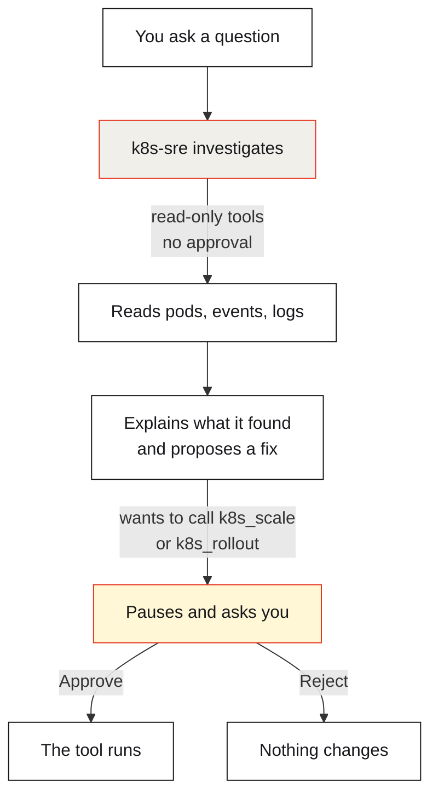

**By Sebastian Maniak**

The first thing people ask when they see an agent with Kubernetes access is "what stops it from deleting something?" It's the right question. This post builds an agent with a clear answer to it.

**`k8s-sre`** works like a careful site reliability engineer:

- It **reads the cluster on its own** to find out what's wrong. Pods, events, logs, describe output. No permission needed.
- It **stops and asks you** before it changes anything. You see the exact call it wants to make, and you approve or reject it.

You build it in the kagent UI in about five minutes, with no code. The steps follow the [Build a K8s SRE](https://kagent.dev/docs/kagent/latest/get-started/k8s-sre/) tutorial in the kagent docs. I've written out every step from an empty cluster, and added a broken deployment so the agent has something real to investigate.


*From the kagent docs: creating the `k8s-sre` agent with two sets of tools, sped up.*

---

## How it works

kagent installs an MCP server called `kagent-tool-server` that has tools for Kubernetes. You give the agent those tools in **two separate sets**:

| Set | Tools | Approval |
|---|---|---|
| Read-only | `k8s_get_resources`, `k8s_describe_resource`, `k8s_get_events`, `k8s_get_pod_logs` | None. The agent calls these freely. |
| Changes the cluster | `k8s_scale`, `k8s_rollout` | Required on every call. |

The agent also gets nothing else. It has no delete tool and no patch tool, so it can't delete or patch, with or without approval.



Because this is kagent 1.0, the agent runs on **Agent Substrate**. Each conversation runs in its own gVisor sandbox, and the sandbox can only reach the model and the MCP server the agent names. You don't configure any of that. It's how every agent on the platform runs.

## What you need

- A Kubernetes cluster at **version 1.37 or later**. A local kind cluster is fine.
- [`kubectl`](https://kubernetes.io/docs/tasks/tools/#kubectl) and [`helm`](https://helm.sh/docs/intro/install/) 3.
- [`kind`](https://kind.sigs.k8s.io/docs/user/quick-start/#installation) v0.32.0 or later, if you're creating a local cluster.
- An API key for a model provider. These steps use OpenAI.

## Step 1: Create a cluster

Skip this step if you already have a 1.37+ cluster.

```bash
kind create cluster --name kagent --image kindest/node:v1.37.0
```

## Step 2: Install kagent

Set your API key:

```bash
export OPENAI_API_KEY="your-api-key-here"
```

Install the kagent CLI, and then use it to install kagent into the cluster:

```bash
curl -sL https://kagent.dev/install | bash && kagent install
```

The second command installs the CRDs, Agent Substrate, a development PostgreSQL database and kagent. It takes a few minutes.

If you use a different provider, set that provider's key and name it. For example:

```bash
export ANTHROPIC_API_KEY="your-api-key-here"
curl -sL https://kagent.dev/install | bash && kagent install --provider Anthropic
```

Check that everything is running:

```bash
kubectl get pods -n kagent
```

Every pod should report `Running`. You should see the controller, the UI, the tools server (`kagent-tools`), PostgreSQL and a `kagent-default` worker.

## Step 3: Open the UI

```bash
kagent dashboard
```

This opens the kagent UI in your browser. Leave the command running.

## Step 4: Create the agent

1. In the sidebar, click **Agents**, and then click **New Agent**.
2. In the **Name** field, enter `k8s-sre`.
3. Leave the **Namespace** as `kagent`.
4. Leave **Shared harness** set to `kagent-default`.
5. In the **Template** section, select **Inline**.
6. Set **Model configuration** to `kagent/default-model-config`.
7. In the **Description** field, enter `Kubernetes SRE that investigates before it acts`.
8. In the **System prompt** field, enter this prompt:

   ```text
   You are a Kubernetes site reliability engineer.
   Investigate with your read-only tools before you suggest a change.
   Explain what you found, then propose the smallest fix.
   Never guess. When the tools cannot answer, say so.
   ```

Don't click **Create agent** yet. You add the tools first, in the next two steps.

The prompt is four lines, and each one does a job:

- **"Investigate before you suggest a change"** makes the agent look first. Without it, a model will happily propose a restart from the question alone.
- **"Explain what you found"** means you see the evidence before you see the fix.
- **"The smallest fix"** keeps it from proposing a rollout restart when scaling would do.
- **"Never guess"** tells it to say when the tools can't answer, so you aren't handed a confident wrong diagnosis.

## Step 5: Give it read-only tools

Still on the same form:

1. Under **Tools from MCP servers**, click **Add an MCP server**.
2. From the **MCP server** list, choose `kagent/kagent-tool-server`.
3. From the tool list beside it, choose these four tools. You can type part of a name to find one.

   | Tool | What it does |
   |---|---|
   | `k8s_get_resources` | Lists resources, such as pods and deployments |
   | `k8s_describe_resource` | Describes one resource |
   | `k8s_get_events` | Reads events |
   | `k8s_get_pod_logs` | Reads the logs of a pod |

4. Leave **Require approval** cleared for this set.

## Step 6: Give it tools that need approval

This is the step that makes the agent safe to use. You add the same MCP server a second time, with different tools and a different setting.

1. Click **Add an MCP server** again.
2. Choose `kagent/kagent-tool-server` a second time.
3. From the tool list, choose `k8s_scale` and `k8s_rollout`.
4. Select **Require approval**.
5. Click **Create agent**.
6. Click **Refresh** until the agent is **Ready**.

Adding the server twice looks odd, but it's how approval works in kagent 1.0. **Approval belongs to the set of tools, not to a tool name.** One server can supply tools that run freely and tools that pause, as long as they're in separate sets.

## Step 7: Give it something to find

A healthy cluster makes a dull test. This part isn't in the kagent tutorial. I've added it so the agent has a real problem to investigate. Create a deployment with an image tag that doesn't exist:

```bash
kubectl create deployment broken-demo --image=nginx:this-tag-does-not-exist
```

Give it a minute, then check it yourself so you know the right answer:

```bash
kubectl get pods -l app=broken-demo
```

The pod should be stuck in `ErrImagePull` or `ImagePullBackOff`.

## Step 8: Ask it about the cluster

1. On the **Agents** page, click the agent name, `k8s-sre`, to open its chat page.
2. Ask a question that the read-only tools can answer:

   ```text
   Are any pods in the default namespace unhealthy?
   ```

   The agent calls its read-only tools without stopping. You see each tool call in the conversation, followed by its explanation. For the broken deployment, it should find the pod, read its events and tell you the image can't be pulled.

3. Ask a follow-up to see it use the other read tools:

   ```text
   Why is the broken-demo pod failing? Show me the events.
   ```

Notice what it doesn't do. It can't fix this one, because the fix is a new image and it has no tool that edits a deployment. A well-behaved run ends with the agent telling you what to change, not with it trying something else.

## Step 9: Ask for a change, and approve it

Now ask for something the agent does have a tool for:

```text
Scale the kagent-ui deployment to 2 replicas.
```

This time the agent pauses. Before it calls `k8s_scale`, the UI shows you the pending call, with the tool name and the arguments the agent chose, and waits for you to **approve** or **reject** it.

Read the arguments before you click. Check the deployment name, the namespace and the replica count. This is the whole point of the exercise.

Approve it, and then check the result yourself:

```bash
kubectl get deployment kagent-ui -n kagent
```

The deployment should show 2 replicas.

## Step 10: Reject a change

Try the other path too:

```text
Scale the kagent-ui deployment to 5 replicas.
```

When the agent pauses, **reject** the call. Nothing changes in the cluster, and the agent is told its call was rejected. If your client sends a reason with the rejection, the agent receives it and can adjust what it does next.

Check again to confirm nothing moved:

```bash
kubectl get deployment kagent-ui -n kagent
```

It should still show 2 replicas.

## The YAML version

Everything you did in the UI is stored as a Kubernetes resource. To create the same agent from the command line, or to keep it in a Git repository, apply this YAML.

```yaml
kubectl apply -f - <<EOF
apiVersion: api.kagent.dev/v1alpha3
kind: Agent
metadata:
  name: k8s-sre
  namespace: kagent
spec:
  harnessRef:
    name: kagent-default
  template:
    inline:
      description: Kubernetes SRE that investigates before it acts
      modelConfig:
        name: default-model-config
      systemPrompt: |-
        You are a Kubernetes site reliability engineer.
        Investigate with your read-only tools before you suggest a change.
        Explain what you found, then propose the smallest fix.
        Never guess. When the tools cannot answer, say so.
      tools:
        - mcp:
            server:
              kind: RemoteMCPServer
              name: kagent-tool-server
            tools:
              - k8s_get_resources
              - k8s_describe_resource
              - k8s_get_events
              - k8s_get_pod_logs
        - mcp:
            requireApproval: true
            server:
              kind: RemoteMCPServer
              name: kagent-tool-server
            tools:
              - k8s_scale
              - k8s_rollout
EOF
```

The two `mcp` entries are the two sets from steps 5 and 6. The only difference between them is the tool list and the line `requireApproval: true`.

## Things to know

- **Leave the tool list empty and you bind every tool.** If a set has no `tools` list, it exposes everything the server offers. With `requireApproval: true` that means every tool pauses. Without it, every tool runs freely. Always list the tools.
- **Approval needs a client that supports it.** The kagent UI does. The `kagent` CLI doesn't: `kagent agent invoke` reports `Input required to continue this Session.` and can't answer the request. Use the UI for this agent.
- **Splitting one server into two sets needs the `kagent` harness.** The `codex` and `claude` harnesses reject a second set for the same server, so on those you get one approval setting for the whole server.
- **A waiting agent costs nothing.** While it waits for your answer, Agent Substrate suspends the sandbox to a snapshot and frees the worker. You can approve an hour later and it continues from where it stopped.
- **Don't schedule this agent.** Nobody is there to click approve at 3 a.m., so the run waits until it times out. For unattended runs, build a read-only agent like the one in [my scheduled agent post](/articles/2026-11-24-kagent-scheduled-agent-cluster-health-report-agent-substrate/).
- **Built-in tools don't pause.** Approval covers only the tools in a set that requires it. The agent's built-in tools, such as its shell, run without asking. The sandbox is what confines those.

## Clean up

Delete the test deployment and the agent, and put `kagent-ui` back to one replica:

```bash
kubectl delete deployment broken-demo
kubectl scale deployment kagent-ui -n kagent --replicas=1
kubectl delete agent k8s-sre -n kagent
```

To remove the whole kind cluster:

```bash
kind delete cluster --name kagent
```

## Wrap-up

The design here is simple, and I'd use it for any agent that touches infrastructure. Let it read everything it needs. Make it ask before it writes. Don't give it tools it has no reason to hold.

To extend it, add tools one at a time and decide which set each belongs in. A tool that reads goes in the first set. A tool that changes something goes in the second, and you read its arguments every time until you trust it.

Related reading:

- [Build a K8s SRE](https://kagent.dev/docs/kagent/latest/get-started/k8s-sre/), the kagent tutorial this post follows
- [Human in the loop](https://kagent.dev/docs/kagent/latest/agents/human-in-the-loop/) in the kagent docs, for how tool approval works
- [Build a scheduled agent with kagent and Agent Substrate](/articles/2026-11-24-kagent-scheduled-agent-cluster-health-report-agent-substrate/)
- [Build a CVE agent with kagent and Agent Substrate](/articles/2026-11-24-kagent-cve-agent-substrate-secure-sandbox/)
