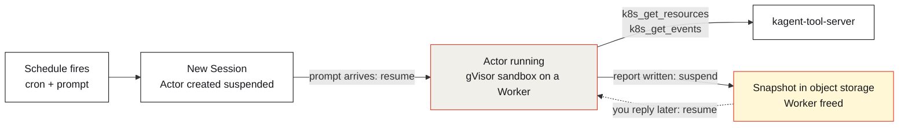

**By Sebastian Maniak**

Most agent demos start with a person typing a question. The agents I get the most value from are the ones nobody talks to: they wake up on a timer, do one job, and leave the result where I'll find it.

This post builds the smallest version of that. **`cluster-reporter`** reads your Kubernetes cluster once a day and writes a health report of ten lines or fewer. It runs on **kagent 1.0**, where every agent runs on **Agent Substrate**, and that changes what "scheduled" costs you:

- A schedule is a **cron expression and a prompt**. There's no CronJob and no pod waiting around for 7 a.m.
- Each run is a **new session in its own gVisor sandbox**.
- When the report is written, Substrate **suspends** the sandbox to a snapshot and frees the worker.

The steps follow the [Build a scheduled agent](https://kagent.dev/docs/kagent/latest/get-started/scheduled-agent/) tutorial in the kagent docs. I've added what happens on Substrate between runs, the API calls for creating the schedule without the UI, and the execution rules worth knowing before you depend on one.


*From the kagent docs: creating the `cluster-reporter` agent and its daily schedule, sped up.*

---

## What you build

| Piece | What it is |
|---|---|
| `cluster-reporter` | An `Agent` on the `kagent-default` harness with two read-only Kubernetes tools |
| `nightly-health-report` | A daily schedule that sends the agent one prompt: `Write the health report for all namespaces.` |

The tools come from `kagent-tool-server`, the MCP server that kagent installs. The agent gets `k8s_get_resources` and `k8s_get_events`, and nothing that writes.

## What a scheduled run does on Agent Substrate

On kagent 1.0 an agent isn't a Deployment. Its loop runs inside an **Actor**, a sandboxed unit of compute that Agent Substrate creates, suspends and resumes on a pool of Workers. A schedule drives that cycle on a timer.



Here's the sequence for one run:

1. **The schedule fires.** kagent creates an execution record and a new Session for it. Creating a Session doesn't start anything running. The Actor is created suspended.
2. **The prompt resumes the Actor.** kagent sends the schedule's prompt to the Session. Substrate restores the Actor onto a Worker that has room and delivers the message.
3. **The agent works.** It calls its two tools, reads pods and events, and writes the report.
4. **Substrate suspends the Actor.** kagent suspends at every turn boundary, as soon as nothing in the Session is running. The Actor's durable data goes to a snapshot and the Worker's capacity is released.

Between runs, the agent uses no compute. And because the Session stays `READY` while its Actor is suspended, you can open yesterday's report and ask a follow-up question. The next message resumes the same Actor from its snapshot.

The sandbox also matters more for an agent that runs unattended. Nobody is watching the tool calls at 3 a.m., so the limits have to be built in:

- The Actor's system calls go to **gVisor's user-space kernel**, not to the host kernel.
- **Egress is default-deny.** kagent derives the allowlist from the agent's template, so `cluster-reporter` can reach its model and the MCP server it names, and nothing else.
- The agent has **only tools that read**. That's a choice you make in the form, and it's the most important one in this post.

> I covered the sandbox and egress side in more detail in [Build a CVE agent with kagent and Agent Substrate](/articles/2026-11-24-kagent-cve-agent-substrate-secure-sandbox/).

## Before you begin

You need a Kubernetes cluster at **1.37 or later**, plus `kubectl` and `helm` 3. A local kind cluster works, with kind v0.32.0 or later:

```bash
kind create cluster --name kagent --image kindest/node:v1.37.0
```

Set your model provider's API key, then install the CLI and kagent. This installs the CRDs, Agent Substrate, a development PostgreSQL database and kagent.

```bash
export OPENAI_API_KEY="your-api-key-here"
curl -sL https://kagent.dev/install | bash && kagent install
```

`kagent install` uses OpenAI by default. For another provider, set that provider's key and pass `--provider`, for example `kagent install --provider Anthropic`.

Then open the UI:

```bash
kagent dashboard
```

## Step 1: Create the agent

1. In the sidebar, click **Agents**, and then click **New Agent**.
2. In the **Name** field, enter `cluster-reporter`. Leave the **Namespace** as `kagent`, and leave **Shared harness** set to `kagent-default`.
3. In the **Template** section, select **Inline**, and fill it in.

   | Field | Value |
   |---|---|
   | **Model configuration** | `kagent/default-model-config` |
   | **Description** | `Writes a short cluster health report` |

4. In the **System prompt** field, enter this prompt.

   ```text
   You write a short health report for a Kubernetes cluster.
   List pods that are not Running or Ready, and recent Warning events.
   Keep the report under ten lines. If everything is healthy, say so in one line.
   ```

5. Under **Tools from MCP servers**, click **Add an MCP server**, and choose `kagent/kagent-tool-server`. From the tool list beside it, choose `k8s_get_resources` and `k8s_get_events`.
6. Click **Create agent**, and then click **Refresh** until the agent is **Ready**.

A few notes on why the agent looks like this:

- **The prompt sets a length.** A report you read every morning has to be short, or you stop reading it. "Under ten lines" and "one line if healthy" keep it that way.
- **The prompt says what to look for.** Pods that aren't Running or Ready, and Warning events. Without that, every run picks its own definition of "health".
- **Two tools, both read-only.** `kagent-tool-server` has tools that change the cluster too. An agent that runs with nobody watching shouldn't have them.

## Step 2: Schedule it

1. In the sidebar, click **Schedules**, and then click **New Schedule**.
2. From the **Agent** list, choose `kagent/cluster-reporter`.
3. In the **Name** field, enter `nightly-health-report`.
4. Leave **Repeat** set to **Daily**, and set **At time** and **Time zone** to when you want the report.
5. In the **Prompt** field, enter `Write the health report for all namespaces.`
6. Leave **Enable Schedule** on, and click **Create schedule**.

The **Time zone** field starts as `UTC` and takes an IANA name such as `America/Toronto`. The schedule follows daylight-saving changes in the zone you pick.

**Repeat** has more options than Daily:

| Option | What it asks for |
|---|---|
| **Every few minutes** | An interval of 1, 5, 10, 15, 20 or 30 minutes |
| **Hourly** | The minute past the hour |
| **Daily** | The time |
| **Weekly** | The days and the time |
| **Monthly** | The day of the month and the time |
| **Custom (advanced)** | A five-field cron expression |

## Step 3: Read the reports

The schedule's page shows the next execution and an **Execution history** table. You don't have to wait for the first one. Click **Run** to start an execution now. A manual run doesn't change the next scheduled time.

Each row of the table shows the trigger, the state and a failure reason if there is one. Click **Open conversation** on a row to read that run's report. It's a normal conversation, so you can reply in it, for example `Why is that pod in CrashLoopBackOff?`, and the agent picks up from its report.

The other buttons on the page:

| Button | Action |
|---|---|
| **Run** | Start a run now. This also works on a paused schedule. |
| **Pause** / **Resume** | Stop or restart future scheduled runs. |
| **Edit** | Change the times, the prompt or the timeout. |
| **Delete schedule** | Stop future runs. The history and the conversations stay. |

## The YAML version

The agent is a Kubernetes resource, so you can keep it in git.

```yaml
kubectl apply -f - <<EOF
apiVersion: api.kagent.dev/v1alpha3
kind: Agent
metadata:
  name: cluster-reporter
  namespace: kagent
spec:
  harnessRef:
    name: kagent-default
  template:
    inline:
      description: Writes a short cluster health report
      modelConfig:
        name: default-model-config
      systemPrompt: |-
        You write a short health report for a Kubernetes cluster.
        List pods that are not Running or Ready, and recent Warning events.
        Keep the report under ten lines. If everything is healthy, say so in one line.
      tools:
        - mcp:
            server:
              kind: RemoteMCPServer
              name: kagent-tool-server
            tools:
              - k8s_get_resources
              - k8s_get_events
EOF
```

The schedule is different. **A schedule is not a Kubernetes resource.** kagent stores schedules in its database, so there's no YAML for one, GitOps won't restore it, and the `kagent` CLI doesn't manage it. Without the UI, you use the API.

## Create the schedule with the API

The `kagent.api.v1.ScheduledRunService` gRPC API has the same operations as the UI. These calls use [grpcurl](https://github.com/fullstorydev/grpcurl), which needs gRPC server reflection on the controller. `kagent install` turns that on. With a Helm install, set `config.server.grpcReflection=true`.

Port-forward the controller and leave it running:

```bash
kubectl port-forward -n kagent svc/kagent-controller 8083:8083
```

Create the schedule. This one runs at 07:00 every day:

```bash
grpcurl -plaintext -d '{
  "agent": {"namespace": "kagent", "name": "cluster-reporter"},
  "request_id": "nightly-health-report-1",
  "config": {
    "name": "nightly-health-report",
    "schedule": "0 7 * * *",
    "time_zone": "America/Toronto",
    "prompt": "Write the health report for all namespaces.",
    "execution_timeout": "900s"
  }
}' localhost:8083 kagent.api.v1.ScheduledRunService/CreateScheduledRun
```

The response has the schedule's `id` and `etag`. Save the `id`:

```bash
export SCHEDULE_ID=<id>
```

Start a run now, which is the API version of the **Run** button:

```bash
grpcurl -plaintext -d @ localhost:8083 kagent.api.v1.ScheduledRunService/TriggerScheduledRun <<EOF
{
  "scheduled_run_id": "$SCHEDULE_ID",
  "request_id": "manual-run-1"
}
EOF
```

Then check on it with the `execution.id` from that response:

```bash
grpcurl -plaintext -d @ localhost:8083 kagent.api.v1.ScheduledRunService/GetScheduledRunExecution <<EOF
{
  "execution_id": "<execution_id>"
}
EOF
```

When the state is `SCHEDULED_RUN_EXECUTION_STATE_SUCCEEDED`, the `sessionId` in the response is the conversation that holds the report.

Things to know about the API:

- **`request_id` makes a call safe to retry.** The same `request_id` with the same inputs returns the existing schedule. The same `request_id` with different inputs returns `AlreadyExists`.
- **`schedule` is five-field cron only.** kagent rejects macros such as `@daily`.
- **`UpdateScheduledRun` replaces the whole config.** Send every field you want to keep. A field you leave out goes back to its default, so a missing `time_zone` becomes UTC. The call also needs the current `etag`.
- **You can't move a schedule to another agent.** Delete it and create a new one.

## How executions behave

These are the rules I'd read before trusting a schedule with anything that matters.

| State | Meaning |
|---|---|
| `PENDING` | kagent accepted the execution and is preparing its Session |
| `RUNNING` | kagent sent the prompt to the agent |
| `SUCCEEDED` | The agent's task completed |
| `FAILED` | The task ended in another state, or the Session was deleted first. `failure_reason` says why |
| `TIMED_OUT` | The execution timeout elapsed before the task ended |

- **The timeout defaults to 900 seconds, and it includes startup.** The clock starts when kagent accepts the execution, so it covers queueing and Actor provisioning as well as the agent's work. A slow model or a big cluster needs more. I run local-model agents at 2400 seconds.
- **Missed times are skipped.** If kagent can't accept an execution within 30 seconds of its scheduled time, it skips that run and waits for the next. A controller outage doesn't cause a burst of catch-up runs, but it also means a report can be missing. Check the history.
- **A prompt is sent once.** If the runtime doesn't accept it, kagent doesn't resend, because a resend could duplicate the agent's work.
- **Edits apply to future runs.** An execution uses the prompt and timeout that were current when it was accepted.
- **A deleted agent fails slowly.** If the Agent is gone or has no ready revision, each execution sits in `PENDING` until the timeout and ends as `TIMED_OUT`.

## Who owns a schedule

A schedule belongs to the user who created it. Only the creator can see, change, trigger or delete it, and the conversations it creates belong to the same creator. Each run uses the credentials configured on the Agent, not the creator's.

That protection depends on how the controller authenticates callers. `config.server.auth.mode` defaults to `insecure`. In that mode the caller supplies its own identity in the `X-User-Id` header, and a call without the header runs as `admin@kagent.dev`. That's fine on a kind cluster on your laptop. On a shared cluster, put the controller behind an authenticating boundary before you rely on ownership. The docs cover the modes in [Controller identity](https://kagent.dev/docs/kagent/latest/about/substrate-runtime/identity/).

## Clean up

Delete the schedule from its page in the UI, or with the API:

```bash
grpcurl -plaintext -d @ localhost:8083 kagent.api.v1.ScheduledRunService/DeleteScheduledRun <<EOF
{
  "scheduled_run_id": "$SCHEDULE_ID"
}
EOF
```

Then delete the agent:

```bash
kubectl delete agent cluster-reporter -n kagent
```

## Wrap-up

`cluster-reporter` is one prompt, two read-only tools and one cron line. The platform does the rest. Agent Substrate gives each run its own sandbox, closes the network except for what the agent's template names, and puts the agent back to sleep the moment the report is done.

The same pattern works for bigger jobs. Change the prompt and the tools, and you have a CVE check, a firmware audit or an upstream digest. Two things to do as you grow it:

- **Keep unattended agents read-only** until you've read enough of their reports to trust them.
- **Back up your schedules.** They live in the kagent database, not in git, so save the `CreateScheduledRun` calls somewhere you can replay them.

Related reading:

- [Build a scheduled agent](https://kagent.dev/docs/kagent/latest/get-started/scheduled-agent/), the kagent tutorial this post follows
- [Scheduled runs](https://kagent.dev/docs/kagent/latest/agents/scheduled-runs/) and [Suspend and resume](https://kagent.dev/docs/kagent/latest/about/substrate-runtime/suspend-and-resume/) in the kagent docs
- [Build a CVE agent with kagent and Agent Substrate](/articles/2026-11-24-kagent-cve-agent-substrate-secure-sandbox/)
- [Agents that sleep until their schedule fires](/articles/2026-11-19-kagent-enterprise-scheduled-agents-daily-reports/), eight scheduled agents on kagent Enterprise
