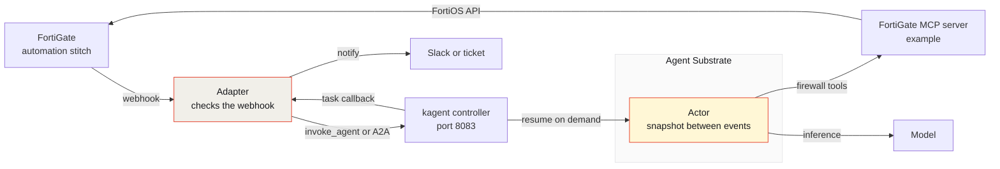
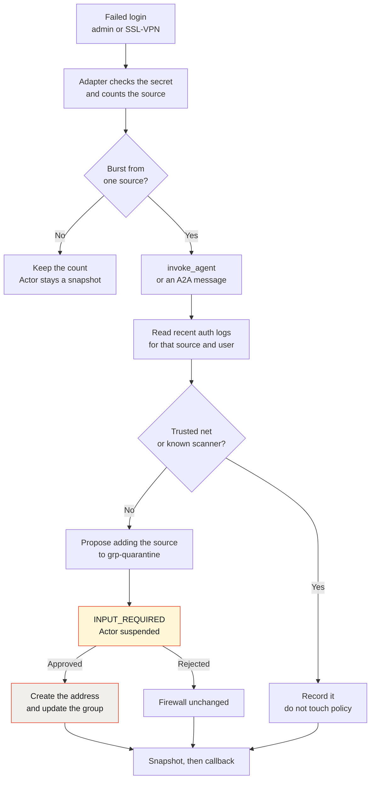
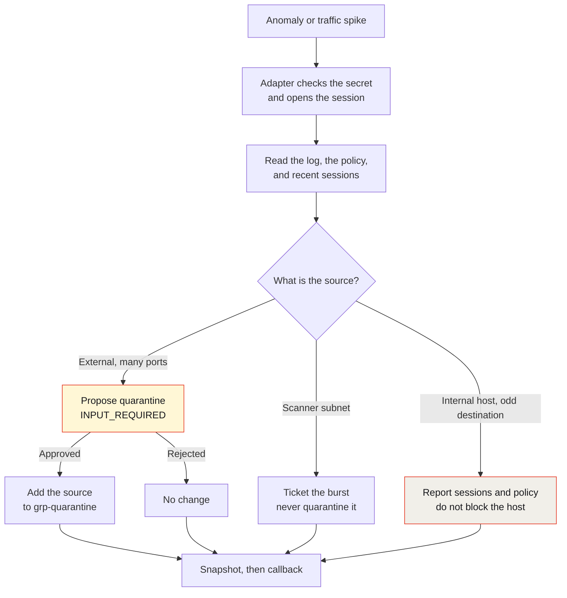
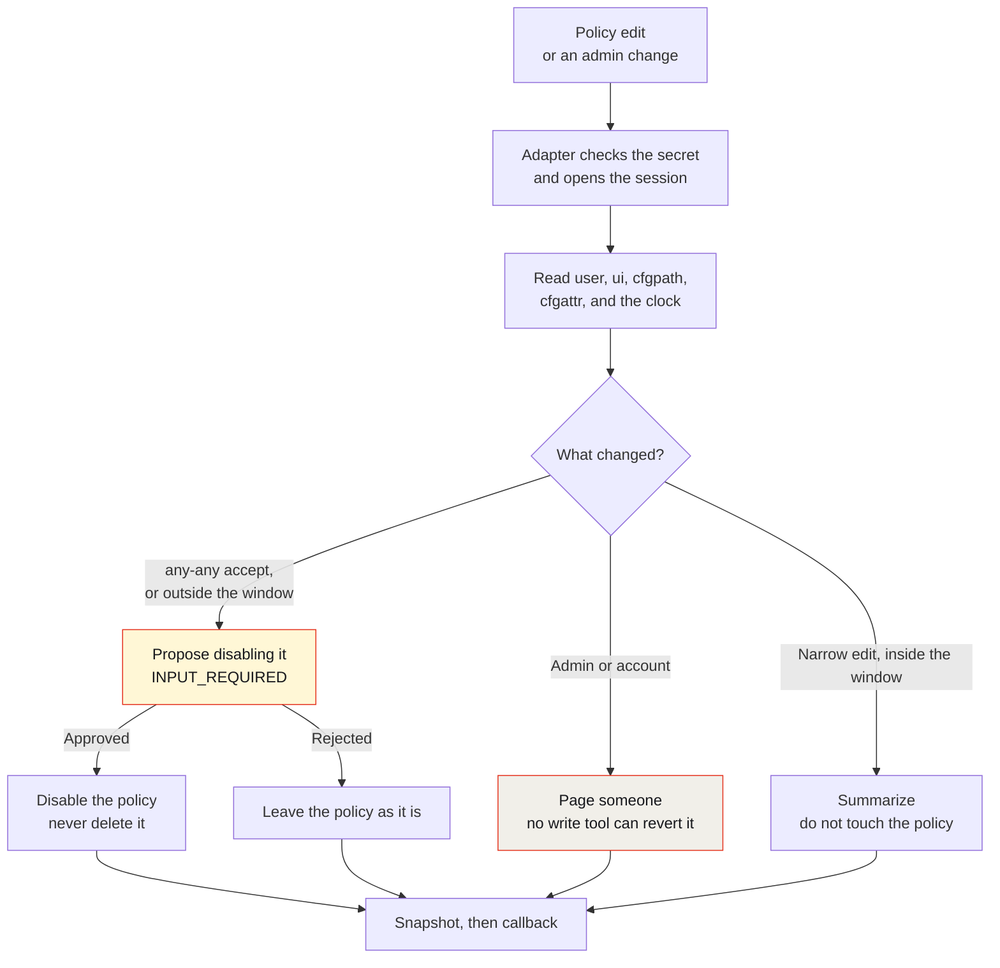

**By Sebastian Maniak**

It's a little after 2 a.m. The FortiGate on the lab bench just logged another failed admin login, from an address I don't recognize. Someone has to figure out whether that's a typo, a scanner I forgot, or a person guessing passwords. Right now that someone is me, half awake, reading one log line.

I don't want to sit there and sort it out by hand. I also don't want a program left running all night with the firewall's token on it. I want the box to tap the cluster, have an agent look, and then go quiet until the next tap.

This post is that setup, on kagent 1.0.1. kagent is the controller I run in the cluster to host the agent and keep the conversation. Agent Substrate is the sandbox under that agent, so the session only runs while it has work and is then saved as a snapshot. I'll show how a FortiGate alert reaches the agent, what it's allowed to change, and how you can try the same path on a firewall you own.

The next section is the whole trip, from that log line to the person who has to say yes.

---

## How an event gets to the agent



Read it left to right. Then follow the note that comes back to Slack.

The firewall is the only thing that starts a run. A small adapter in the cluster is the only thing that talks to kagent. The running session, which kagent calls an Actor, is the only thing that calls tools. The FortiGate tool server is the only thing that holds the firewall token. Slack never hears from the sandbox. It hears from the adapter, after kagent says the work is waiting or finished.

kagent won't take that webhook itself. On 1.0.1 it can start an agent from a schedule, from a tool call named `invoke_agent`, or from an A2A message. There's no inbound webhook. That's why the adapter sits in front. If a built-in trigger shows up later, I still want something there that understands a FortiGate payload.

### Two ways to wake the same agent

Both doors are on the controller, port `8083`. A default install serves that as the Service `kagent-controller`. A2A is built in. Every agent is reachable that way. I still start most runs through MCP, because that's also how I list agents and poll a long turn.

| How the adapter calls | Where |
|---|---|
| MCP, the path I use | `POST /mcp`, tool `invoke_agent` |
| A2A over HTTP | `POST /agents/kagent/fortigate-responder` |
| A2A over gRPC | `lf.a2a.v1.A2AService`, tenant `kagent/fortigate-responder` |

The agent card is `GET /agents/kagent/fortigate-responder/.well-known/agent-card.json`. Every A2A call needs the header `A2A-Version: 1.0`. Without it the controller rejects the call.

MCP isn't a second runtime. The controller's MCP server is a front door onto that same A2A service.

`list_agents` shows the agents the caller can see. `invoke_agent` sends one message. Pass `agent` to start a session, or `session_id` to continue one, and only one of those two. A stable `message_id`, reused with the same agent and the same message, retries the first turn instead of starting another one.

A FortiGate stitch won't wait for a model. If the adapter declares the tasks extension, `io.modelcontextprotocol/tasks`, `invoke_agent` returns a task to poll with `tasks/get` instead of blocking. Every poll has to repeat that declaration.

The A2A version of the same call is a `SendMessage` to `/agents/kagent/fortigate-responder`. Leave out `contextId` to start a session. Send the same `contextId` to continue it. That id is the session id. Use this door when the caller already speaks A2A. I use MCP for the lab adapter.

```json
{
  "jsonrpc": "2.0",
  "id": "1",
  "method": "SendMessage",
  "params": {
    "message": {
      "messageId": "fw-maniak-hq-0100032002-203.0.113.50",
      "role": "ROLE_USER",
      "parts": [{ "text": "Admin login failed from 203.0.113.50. Count so far: 8." }]
    }
  }
}
```

Post that body to `/agents/kagent/fortigate-responder` with `Content-Type: application/json` and `A2A-Version: 1.0`.

The docs for both doors are [Call an agent over A2A](https://kagent.dev/docs/kagent/latest/examples/a2a-agents/) and [Use agents from an MCP client](https://kagent.dev/docs/kagent/latest/examples/agents-via-mcp/).

---

## Lock the adapter and the controller

The path above is only worth running if a stranger on the network can't pretend to be the firewall.

The adapter has one job. It checks the caller, turns the body into one event, and hands that event to kagent. It doesn't call FortiOS, and it doesn't hold the REST token. It also doesn't decide that an address is bad. The agent does that, because the agent can read the logs around the event.

FortiOS will send the headers you put on the webhook action. It won't sign the body for you. The check the stitch can actually do is TLS, plus a shared secret in a header. The adapter compares that secret in constant time and answers 401 when it's missing or wrong. mTLS belongs at the ingress if you want a certificate. I pick one and fail closed.

The controller's default auth mode is `insecure`. In that mode the caller names itself with `X-User-Id`, and a call with no header runs as `admin@kagent.dev`. That's fine on a laptop. It's the wrong mode once a webhook can reach the cluster.

I set `config.server.auth.mode` to `trusted-proxy`. The caller must send `Authorization: Bearer`. The controller reads the identity from the claim in `config.server.auth.userIdClaim`, which defaults to `sub`. It does not check the token's signature. The proxy in front of port `8083` has to do that. A pod that can open the port directly can still present a token it wrote, so a NetworkPolicy that admits only the adapter is part of the control.

---

## The agent sleeps, and it asks before it writes

Once the call can get in, the next question is what the agent is doing the rest of the night.

Agent Substrate runs the session as an Actor in its own sandbox. The default class is gVisor. A worker pool can use `microvm` when you want a virtual machine instead. I use the harness named `kagent-default`, which is the kagent runtime from a normal install.

When a turn finishes, a lifecycle worker suspends the Actor to a snapshot and frees the worker. The next event resumes that snapshot. A suspended Actor costs nothing.

Approval uses that same pause. On the write tools I set `requireApproval: true`. The flag belongs to the set of tools, not to one tool name.

When the model wants one of those tools, the task moves to `INPUT_REQUIRED` before the call runs. The Actor is suspended while it waits, so I can answer an hour later and it continues.

The client has to be able to answer, or the pause just sits there.

On A2A, send `A2A-Extensions: https://kagent.dev/extensions/hitl/v1` with the message. The pause comes back as a `tool_approval_request`. Answer on the same task with a `tool_approval_response`. If you forget the header, the task still stops, and you have no id to answer with.

An MCP client that declared the tasks extension sees the pause as `input_required` and answers with `tasks/update`. The `kagent` CLI reports that input is required and can't answer it, so I don't point approval at the CLI.

How that pause works is written up in [Human in the loop](https://kagent.dev/docs/kagent/latest/agents/human-in-the-loop/).

### Tell Slack when it is waiting, or done

kagent can POST to a webhook when a task reaches a state worth knowing about. The states are `INPUT_REQUIRED`, `AUTH_REQUIRED`, and the terminal ones: `COMPLETED`, `FAILED`, `CANCELED`, and `REJECTED`. Ordinary progress does not fire it.

Register the URL on the A2A send, in `configuration.taskPushNotificationConfig`, or add it later while the task is still active.

The body is a `statusUpdate` with the task id, the context id, and the state. The receiver then calls authenticated `GetTask` for the real transcript. Deliveries can arrive twice or out of order, so `GetTask` is the source of truth. Any HTTP 2xx acknowledges the POST. A redirect counts as a failure, so register the final URL.

By default the POST has no `Authorization` header, and `/.well-known/jwks.json` returns 404. To sign them, put an Ed25519 key in a Secret and set `controller.push.signing.secretName`. The issuer is `config.push.issuer`. Callbacks also refuse plain HTTP and private addresses unless you set `config.push.allowHttp` and `config.push.allowPrivateNetworks`. I only turn those on for a receiver inside the lab network.

The adapter is that receiver. It turns `INPUT_REQUIRED` into a Slack approval, and `COMPLETED` into a ticket comment. The sandbox never opens a connection to Slack.

---

## The two objects I apply

The behavior above is two Kubernetes objects. The adapter is ordinary code. It isn't one of them.

The FortiGate MCP server is mine to build. I run it in the cluster and point a `RemoteMCPServer` at it. The API group is `api.kagent.dev/v1alpha3`. `description` and `url` are required. `protocol` is `STREAMABLE_HTTP` or `SSE`. I use `STREAMABLE_HTTP`.

The URL is an example. I use the full DNS name because that is unambiguous from a sandbox. The firewall token is a Secret-backed header. The egress gateway injects it. The Actor never sees the token. That is the same split I used when I [asked the firewall questions from a sandbox](/articles/2026-08-17-fortigate-sandboxagent-kagent-howto/).

```yaml
apiVersion: api.kagent.dev/v1alpha3
kind: RemoteMCPServer
metadata:
  name: fortigate-mcp
  namespace: kagent
spec:
  description: Example FortiGate MCP server for the lab firewall.
  url: http://fortigate-mcp.kagent.svc.cluster.local:8084/mcp
  protocol: STREAMABLE_HTTP
  timeout: 30s
  headersFrom:
    - name: Authorization
      valueFrom:
        type: Secret
        name: fortigate-mcp
        key: authorization
```

The tool names below are the catalog I want on that server. They are an example, not built-in kagent tools.

The agent gets two bindings to that one server. Reads run freely. Writes pause. An empty `tools` list would expose every tool the server publishes, so I list them. Splitting one server this way works on the `kagent` harness. The `codex` and `claude` harnesses reject a second binding of the same RemoteMCPServer, so this agent stays on `kagent-default`.

```yaml
apiVersion: api.kagent.dev/v1alpha3
kind: Agent
metadata:
  name: fortigate-responder
  namespace: kagent
spec:
  harnessRef:
    name: kagent-default
  template:
    inline:
      description: Investigates FortiGate events and asks before it changes the firewall.
      modelConfig:
        name: default-model-config
      systemPrompt: |-
        You investigate events from the lab FortiGate.
        Read logs and the current policy before you propose a change.
        One failed login is not an incident. A burst from one untrusted source is.
        Never quarantine the management subnet or the vulnerability-scanner subnet.
        The change window is weekdays 09:00-17:00 America/Toronto.
        Writes you may propose: create an address, add it to grp-quarantine,
        or disable a policy. Never delete, never edit an admin, never touch firmware.
        Outside the window, or for any wider access, stop and ask.
        When a tool cannot answer, say so.
      tools:
        - mcp:
            server:
              kind: RemoteMCPServer
              name: fortigate-mcp
            tools:
              - fg_search_logs
              - fg_get_policy
              - fg_list_admins
        - mcp:
            requireApproval: true
            server:
              kind: RemoteMCPServer
              name: fortigate-mcp
            tools:
              - fg_create_address
              - fg_update_addrgrp
              - fg_set_policy_status
```

`server.kind` must be `RemoteMCPServer`, and `apiGroup` must be left off. kagent rejects anything else.

Egress is default deny, plus whatever kagent infers from the model and the tools. An `EgressPolicy` only adds destinations. I do not attach one. The Actor can reach the FortiGate MCP server and the model. It cannot reach the firewall's management IP, Slack, or the rest of the internet. The MCP pod is a normal pod, and that pod is what talks to FortiOS. I walked through the policy UI in [kagent has a Policies page now](/articles/2026-11-24-kagent-policies-ui-egress-policy-walkthrough/).

The quarantine action stays small. `grp-quarantine` already exists, and a deny policy at the top of the list already references it. The agent may create an address and add it to that group. It may disable a policy. It may not delete one.

### Optional: route to a specialist

If login bursts and policy edits want different prompts, kagent can route them. You bind another `AgentTemplate` as a tool. The fields are `name`, `description`, and `templateRef`. Only the front door needs an `Agent`. The specialists are templates, compiled into the same Actor.

```yaml
tools:
  - subAgent:
      name: login-burst
      description: Repeated failed admin or SSL-VPN logins from one source.
      templateRef:
        name: fortigate-login-burst
  - subAgent:
      name: config-audit
      description: A firewall policy edit, or an admin change.
      templateRef:
        name: fortigate-config-audit
```

Read that as routing, not as a manager that collects answers. Once the front door hands the conversation to a specialist, the specialist keeps it. The parent does not get the specialist's reply back, and it cannot merge two specialists into one report. A later message in that same session stays with the specialist. A different kind of event needs a new session. A specialist also cannot bind a further specialist. kagent rejects that second level.

I keep one agent for the lab. The binding is there when a single prompt gets too long. The walkthrough is [Delegate work to another agent](https://kagent.dev/docs/kagent/latest/examples/agent-delegation/).

---

## Three events

With the agent applied, these are the three things I want it to catch. The samples are shaped like FortiOS logs. They aren't a capture from an attack, and the tool names are the example catalog from above, not tools kagent ships.

| Event | What the agent decides | What it may change, after you approve |
|---|---|---|
| Repeated failed admin or SSL-VPN logins | A burst, or one typo | Add that source to `grp-quarantine` |
| Port scan, or a spike to an odd destination | Your scanner, an outside scan, or an internal host | Quarantine an outside scanner. Do not auto-block an internal host |
| A wide policy, or a change outside the window | Who changed it, and whether access got wider | Disable the policy. Never delete it. Admin edits are report-only |

The adapter keeps one session per incident, keyed by device, event family, and source. A second failure from the same address resumes the snapshot. A new source starts a new session. The JSON under each heading is the body I'd put on the stitch.

### Failed logins

One failure is how I mistype a password. Twenty failures from one address, for `admin` and then for a list of other names, is a guess. FortiOS already has login lockouts. I still want the cluster to see the source, check whether it is my own network, and propose a quarantine that a person accepts.

Admin login failed is log id `32002`. Fortinet's own stitch example uses that id.

```json
{
  "stitch": "admin-login-failed",
  "device": "fw-maniak-hq",
  "log": {
    "logid": "0100032002",
    "type": "event",
    "subtype": "system",
    "level": "alert",
    "vd": "root",
    "user": "admin",
    "srcip": "203.0.113.50",
    "dstip": "172.16.10.1",
    "action": "login",
    "status": "failed",
    "reason": "passwd_invalid",
    "msg": "Administrator admin login failed from https(203.0.113.50) because of invalid password"
  }
}
```

SSL-VPN login failure is a different log. Message id `39426` means "SSL VPN login fail". The source field on that event is `remip`, not `srcip`. The adapter copies `remip` into the same source field, so the prompt does not grow a special case for every log.

```json
{
  "stitch": "sslvpn-login-failed",
  "device": "fw-maniak-hq",
  "log": {
    "logid": "0101039426",
    "type": "event",
    "subtype": "vpn",
    "level": "alert",
    "vd": "root",
    "user": "jsmith",
    "remip": "203.0.113.50",
    "group": "N/A",
    "tunneltype": "ssl-web",
    "action": "ssl-login-fail",
    "reason": "sslvpn_login_unknown_user",
    "msg": "SSL user failed to logged in"
  }
}
```

`203.0.113.50` is a documentation address. `reason` is a hint, not a verdict. `sslvpn_login_unknown_user` can be a typo or a guess. The agent has to look at the count, and at the other names tried from that address, before it calls the burst an attack.



The first webhook under the threshold does not wake an Actor. The adapter can count. Past the threshold, the message tells the agent the source, the user names, and the count. The agent calls `fg_search_logs` for that source, and `fg_list_admins` if the name looks like a real account. It is checking three things. Is the source on a network I manage? Did the failures fan out across many usernames? Did a successful login from that source follow the burst?

The only write I want here is the quarantine group. No new deny policy. No change to the SSL-VPN portal. No edit of the admin account. If the source sits in the management subnet, the prompt says to record it and stop. Locking myself out of the firewall from the cluster is a bad automatic response.

### A port scan, or a spike that does not look like one

The second stitch is a DoS-policy anomaly, or a traffic log that says one internal host just opened a lot of sessions to a destination it never talks to. `tcp_port_scan` is a real anomaly name, and FortiOS logs it as id `0720018432`. I leave the anomaly on monitor until I trust the threshold. The sample below keeps the fields the agent needs. A real log also carries counts.

```json
{
  "stitch": "anomaly-port-scan",
  "device": "fw-maniak-hq",
  "log": {
    "logid": "0720018432",
    "type": "utm",
    "subtype": "anomaly",
    "level": "alert",
    "vd": "root",
    "srcip": "198.51.100.23",
    "dstip": "172.16.10.50",
    "action": "detected",
    "attack": "tcp_port_scan",
    "policyid": 1,
    "policytype": "DoS-policy",
    "msg": "anomaly: tcp_port_scan, 400 > threshold 200"
  }
}
```

A spike to an unusual destination is the case I trust the model with more than a threshold. The agent has to say whether the destination is new, whether the policy that allowed it is the one I think it is, and whether the source is a scanner I run on purpose.



Tool calls, in the order I want them: `fg_search_logs` for the source and the destination, then `fg_get_policy` on `policyid`. A scanner subnet is named in the prompt. Those addresses get a ticket and nothing else. An automation that does not know about the scanner will quarantine it, and then the scanner is down until someone notices.

An outside address scanning many ports can be proposed for `grp-quarantine`. The task stops in `INPUT_REQUIRED` first. An internal host that suddenly talks to a new outside destination is not quarantined. Blocking that host would cut off a person or a build system. The agent reports the sessions, the policy, and the destination. The callback opens the ticket.

### A policy that should not be there

The third stitch is a configuration event. The one I care about is a firewall policy edit that widens access, especially an any-any accept, or any policy edit outside the change window. An admin account change is in the same family and is stricter. The agent reports it. No tool on this agent can revert an admin.

A firewall policy edit is log id `44547`, "Object attribute configured". Log id `44546` is the sibling event for system and global settings, not for a policy object. The body below uses the `44547` fields. The `cfgattr` value is the change I want the agent to notice.

```json
{
  "stitch": "policy-widened",
  "device": "fw-maniak-hq",
  "log": {
    "logid": "0100044547",
    "type": "event",
    "subtype": "system",
    "level": "information",
    "vd": "root",
    "logdesc": "Object attribute configured",
    "user": "admin",
    "ui": "https(198.51.100.10)",
    "action": "Edit",
    "cfgpath": "firewall.policy",
    "cfgobj": "15",
    "cfgattr": "srcintf[port2->any]dstintf[port1->any]srcaddr[LAN->all]dstaddr[servers->all]action[deny->accept]service[HTTPS->ALL]",
    "msg": "Edit firewall.policy 15"
  }
}
```

`cfgattr` is the whole story. Interfaces went to `any`, addresses went to `all`, the action flipped from deny to accept, and the service went from HTTPS to ALL. That is a wide-open policy. The stitch is what gets it to the cluster even if I am asleep.



The agent calls `fg_get_policy` on `cfgobj` and checks that the live policy still matches the log. Logs can arrive late. Someone may already have reverted the edit. If the live policy is still wide, or the edit landed outside weekdays 09:00-17:00 America/Toronto, the agent proposes `fg_set_policy_status` to disable it. Disable, not delete. A disabled policy is one click back. A deleted policy is a reconstruction.

A narrow edit inside the window is a summary in the ticket. I do not want an agent second-guessing a change I just made at my desk.

An admin change takes the other branch on purpose. `fg_list_admins` can show the account. Nothing in the write binding can modify it. Reverting an admin from an automated path is how you lock the real administrators out.

---

## Try it in the lab

The samples above are shapes. This is how I make the real logs show up, or skip the firewall and replay a webhook.

> Run this only against a FortiGate you own, or one you are explicitly allowed to test. The commands below target a lab firewall and a lab VM. Do not point them at a network that is not yours.

Set the lab address once, and do not reuse it for anything else:

```bash
export LAB_FW=172.16.10.1
```

Use a spare admin for the login drill, and keep a console session open. FortiOS will lock an account after enough failures. If that happens, wait out the lockout you configured. Do not test this against the only account that can still manage the box.

On the first pass, reject the approval in the kagent UI. You will see the pause without changing the firewall. Approve once, later, if you want to see the write. Then clean up.

### No firewall yet: replay the webhook

Save one of the JSON samples above as `event.json` and post it at the adapter. The header name is whatever the adapter checks. This one is `X-Stitch-Token`.

```bash
curl -sS -D - -o /dev/null \
  -X POST "https://adapter.lab.example/hooks/fortigate" \
  -H "Content-Type: application/json" \
  -H "X-Stitch-Token: ${STITCH_TOKEN}" \
  --data-binary @event.json
```

The adapter should answer before the model finishes. If curl sits there for a minute, the adapter is blocking on the agent, and a real stitch would have given up. Repeat the command with the same body. A stable `message_id`, derived from the device and the log, should not start a second first turn.

There is nothing to undo on a firewall. Delete the kagent session when you are done looking at it.

### Drill 1: failed logins

Eight wrong passwords, one second apart, against the lab GUI. That is enough to emit admin-login-failed logs. It is not a wordlist.

```bash
for i in 1 2 3 4 5 6 7 8; do
  curl -k -sS -o /dev/null -w "%{http_code}\n" \
    -d "username=lab-test&secretkey=wrong-on-purpose" \
    "https://${LAB_FW}/logincheck"
  sleep 1
done
```

For the SSL-VPN log, use the port your lab VPN is actually listening on. The field name on older pages is sometimes `passwd` instead of `credential`. Copy it from the form if the log does not show up.

```bash
for i in 1 2 3 4 5 6 7 8; do
  curl -k -sS -o /dev/null \
    -d "ajax=1&username=lab-test&credential=wrong-on-purpose" \
    "https://${LAB_FW}:10443/remote/logincheck"
  sleep 1
done
```

If you already use hydra in this lab, point it at `$LAB_FW` only, one password, four threads, and stop. Prefer the curl loop. It always produces the failed-login log, and it does not need a wordlist.

```bash
hydra -t 4 -l lab-test -p wrong-on-purpose -s 443 -S "$LAB_FW" \
  https-post-form "/logincheck:username=^USER^&secretkey=^PASS^:ret="
```

If hydra reports success on the first try, the check string is wrong. Stop. Do not point it at another host to "fix" the string.

### Drill 2: a short port scan

A polite nmap will not cross the default `tcp_port_scan` threshold, which is measured in packets per second. For the lab, write down the current threshold, drop it, set the action to `monitor`, and leave quarantine off. `monitor` logs. It does not block the VM. Quarantine on the DoS policy would.

```bash
config firewall DoS-policy
    edit 0
        set name "lab-scan-monitor"
        set interface "port1"
        set srcaddr "all"
        set dstaddr "all"
        set service "ALL"
        config anomaly
            edit "tcp_port_scan"
                set status enable
                set log enable
                set action monitor
                set threshold 20
            next
        end
    next
end
```

Use the interface the scan actually arrives on. Then, from a lab VM that routes through this firewall, scan a host you own on the far side. Not an address on the internet.

```bash
export LAB_TARGET=172.16.10.50
nmap -Pn -sS -p 1-100 -T4 "$LAB_TARGET"
```

### Drill 3: a temporary any-any policy

Add a policy with a name you can find again. `edit 0` takes the next free id. Write that id down.

```bash
config firewall policy
    edit 0
        set name "lab-temp-any-any"
        set srcintf "any"
        set dstintf "any"
        set srcaddr "all"
        set dstaddr "all"
        set action accept
        set schedule "always"
        set service "ALL"
        set comments "lab test, delete me"
    next
end
```

The same change over the REST API, if you would rather not use the CLI. The token is a read-write API admin on this lab box only.

```bash
curl -k -X POST "https://${LAB_FW}/api/v2/cmdb/firewall/policy" \
  -H "Authorization: Bearer ${LAB_TOKEN}" \
  -H "Content-Type: application/json" \
  -d '{"name":"lab-temp-any-any","srcintf":[{"name":"any"}],"dstintf":[{"name":"any"}],"srcaddr":[{"name":"all"}],"dstaddr":[{"name":"all"}],"action":"accept","schedule":"always","service":[{"name":"ALL"}],"comments":"lab test, delete me"}'
```

Run this outside the change window, or the agent will treat a narrow edit as a summary and stop. An any-any accept should still propose a disable.

### What you should see

1. The adapter answers quickly, then the kagent UI shows a new session on `fortigate-responder`.
2. The turn lists read tools first: `fg_search_logs`, and `fg_get_policy` or `fg_list_admins` when the event needs them.
3. A write stops on an approval card. The task is `INPUT_REQUIRED`. The Actor is suspended while you decide. Reject it if this is the first run.
4. If you registered a callback, Slack or the ticket gets the waiting state, then the finished state. The callback body is a `statusUpdate`. The detail is whatever `GetTask` returns.
5. When the turn is over, the worker is free. Send a second event for the same incident and the same session continues. That resume is the suspend working.

### Clean up

Delete the test policy even if the agent disabled it. A disabled policy is still there.

```bash
config firewall policy
    delete <id>
end
```

Delete the lab DoS policy, or put the old threshold back:

```bash
config firewall DoS-policy
    delete <id>
end
```

If you approved a quarantine, the agent has no delete tool. Remove the address from `grp-quarantine` yourself, then delete the address object. Clear the locked lab admin by waiting out the lockout. Delete the kagent session from the UI when you are finished with the transcript.

---

## What I will not automate

I'll automate the wake-up, the reading, and the recommendation. I'll automate a quarantine only after a person accepts that exact tool call. I won't automate deletes, admin edits, firmware, or a config restore.

Those tools aren't in the binding. A prompt is a request. A missing tool is a wall. The sandbox is the other wall: gVisor or a microVM, a route only to the MCP server and the model, and no work at all between events.

Related reading:

- [Call an agent over A2A](https://kagent.dev/docs/kagent/latest/examples/a2a-agents/)
- [Use agents from an MCP client](https://kagent.dev/docs/kagent/latest/examples/agents-via-mcp/)
- [Delegate work to another agent](https://kagent.dev/docs/kagent/latest/examples/agent-delegation/)
- [Human in the loop](https://kagent.dev/docs/kagent/latest/agents/human-in-the-loop/)
- [Asking My Home FortiGate Questions](/articles/2026-08-17-fortigate-sandboxagent-kagent-howto/)
- [Build a Kubernetes SRE agent that asks before it changes anything](/articles/2026-11-24-kagent-k8s-sre-agent-human-approval-agent-substrate/)
