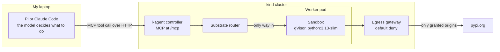

**By Sebastian Maniak**

I use coding agents all day. Claude Code, Pi, Codex. They are good at writing code, and they are even better when they can run it. The part I like less is where it runs: on my laptop, as me, with my SSH keys, my cloud logins and my network.

Think about what that means for a second. I ask an agent a question. It writes a script I haven't read. Then it runs that script on the same machine that can push to production. Most days that's fine. I'd rather not depend on "most days".

So here's what I wanted: let the agent keep running code, but move the running part somewhere safe. Somewhere I control, with rules I set once, that isn't my laptop.

kagent 1.0 does this with two things:

- A **Sandbox** is a throwaway, locked-down box that a person, a script or an agent can spin up to run commands.
- A **SandboxTemplate** is the recipe for that box: which image is inside, and what it's allowed to reach.

kagent also exposes sandboxes over MCP, the protocol coding agents use to call tools. That means any agent that speaks MCP can use one.

In this post I set that up on a local kind cluster and connect two coding agents to it: **Pi** and **Claude Code**. The agent still runs on my machine. The code it writes runs in a sandbox in the cluster. I ran everything here on kagent 1.0.1, and the outputs, screenshots and logs are from those runs.

If you just want the scripts, they're in [sebbycorp/agentsubstrate-kagent-demos](https://github.com/sebbycorp/agentsubstrate-kagent-demos), under `sandbox-templates/`.

**The short version**

- Setup is one Helm value, one template, and one URL in your coding agent.
- The agent's code runs in a gVisor sandbox in the cluster, not on your laptop.
- The sandbox has no network until you grant a specific site.
- A sandbox was ready 125 milliseconds after Pi asked for one.

---

## What you build



Read it left to right. The model and the conversation stay on my machine. Only the *running* moves. When the model wants to run something, Pi or Claude Code asks kagent, and kagent does the work inside a sandbox.

## Why I want this

An agent that can only talk is limited. An agent that can run code can check its own work, crunch data and reproduce bugs. So the real question isn't whether to let it run code. It's where.

| Where the code runs | What goes wrong |
|---|---|
| On the agent's own host or pod | The code has the agent's credentials, network and files. One poisoned document and it can use all three |
| On my laptop | Same problem, with my SSH keys and cloud logins |
| On a CI runner | The runner holds deploy secrets, and nobody has reviewed the code yet |
| In a sandbox | The code gets an empty box: its own files, no credentials, and no network unless I grant a destination |

Here's the idea that changed how I think about it. I'm not trusting the agent. I'm trusting the box. I write the template, and the agent can only pick a template that exists.

| I control, in the template | The agent controls |
|---|---|
| Which image, pinned by digest | Which template to start from |
| Which destinations are reachable | What commands to run |
| CPU, memory and maximum lifetime | When to suspend, resume and delete |

## Security isolation: a controlled environment, not a laptop

This is the heart of it, so I want to slow down here.

When an agent runs code on a laptop, the only thing between that code and everything I own is the agent's good behavior. There's no wall. If the model gets tricked by a bad web page, or just makes a mistake, the code runs with my permissions.

A sandbox on Agent Substrate puts real walls around the code. There are four of them, and none of them depend on the agent behaving.

**1. A separate kernel.** A normal container shares the host's kernel. A sandbox doesn't. By default it runs on [gVisor](https://gvisor.dev), which puts its own kernel, written to run in user space, between the code and the host. When the code makes a system call, gVisor answers it. If you want a stronger wall, a worker pool can use the `microvm` class instead, which runs each sandbox in a small virtual machine.

**2. Its own files.** The sandbox sees its image and its own `/data` volume. It can't see the node's disk, other sandboxes, or the agent's files. In my untrusted-file test further down, the script looked for a Kubernetes service account token. There wasn't one to find.

**3. No way in except one.** Agent Substrate creates a Kubernetes NetworkPolicy for the worker pool. It allows inbound traffic from the Substrate router and nothing else. Here it is on my cluster:

```bash
kubectl get networkpolicy -n kagent
```

```console
NAME                       POD-SELECTOR                         AGE
substrate-kagent-default   ate.dev/worker-pool=kagent-default   88m
```

Its one rule allows ingress from pods labeled `app: atenet-router` in the `ate-system` namespace. So nothing else in the cluster can open a connection to a sandbox. Your CNI has to enforce NetworkPolicy for this to hold, which is worth checking on your own cluster.

**4. No way out unless I say so.** Outbound traffic goes through one egress gateway, and it denies by default. A sandbox reaches a site only if its template selects a policy that lists it. The gateway also knows *which* sandbox is asking, because each one has its own certificate identity, and it logs every request against that identity.

Put together, this is what "controlled environment" means to me:

| | On a laptop | In a sandbox on the cluster |
|---|---|---|
| Who decides what the code can reach | The agent, in practice | The platform team, in a template |
| Credentials within reach | SSH keys, cloud logins, browser sessions | None. A secret can be added at the gateway and never enters the box |
| Network | Whatever the laptop can reach, including the VPN | Nothing, then only the sites you list |
| Record of what happened | Whatever the agent chose to print | Gateway and router logs, per sandbox, in one place |
| Same for everyone | No. Every laptop is different | Yes. One template, pinned by digest |
| When it's done | Files and processes linger | Deleted, or expired by its TTL |

That last column is why I'd rather run this in a cluster than on a developer machine, even a careful one. The rules live in one place. One team sets them. They apply to every agent and every person the same way, and there's a log.

It's not magic, so here's what it doesn't do. Anything you upload to a sandbox is readable by the code in it, so don't upload secrets. A site you allow can be used to send data out, so grant narrowly. And gVisor is a strong boundary but not a virtual machine. If you're running code you actively distrust, use the `microvm` class.

## Before you begin

You need a kind cluster with kagent 1.0 and Agent Substrate. If you don't have one yet, I covered that in [Install kagent locally on kind with one command](/articles/2026-11-24-install-kagent-locally-kind-one-command/). The short version:

```bash
kind create cluster --name kagent --image kindest/node:v1.37.0
export OPENAI_API_KEY=...
kagent install --timeout 20m
```

You also need `jq`, `helm`, Docker with buildx, and the coding agent you want to connect: [Pi](https://pi.dev), Claude Code, or both.

## Step 1: Turn on sandboxes

This is the one step that's easy to miss. kagent runs a small helper program inside every sandbox. It's the thing that actually starts your processes and moves your files. The Helm chart doesn't ship a default image for it, so until you set one, no template ever becomes ready.

```bash
cat > sandbox-values.yaml <<'EOF'
config:
  sandboxes:
    guestImage: ghcr.io/kagent-dev/kagent/sandbox-guest@sha256:354825706868fc4d39300fe7795f4fa04d1eb53c3c93fb5b65b5da76f8222db7
    cpu: "1"          # per sandbox
    memory: 1Gi       # per sandbox
    defaultTtl: 3600s # lifetime when the caller does not ask for one
    maxTtl: 86400s    # upper bound on any requested lifetime
EOF

KAGENT_CHART_VERSION=$(helm list -n kagent -o json \
  | jq -er '.[] | select(.name == "kagent") | .chart | ltrimstr("kagent-")')
helm upgrade kagent oci://ghcr.io/kagent-dev/kagent/helm/kagent \
  --namespace kagent --version "$KAGENT_CHART_VERSION" \
  --reuse-values -f sandbox-values.yaml --wait
```

These values apply to every sandbox in the installation. A template cannot override them.

## Step 2: Create the template

A template names a tools image: the box's contents. Pick an image that already has what you need, because the sandbox can't download anything later unless you grant it. kagent won't accept an image by tag alone, so look up the digest first. Use the digest of the image index, so each node pulls the variant for its own architecture.

```bash
DIGEST=$(docker buildx imagetools inspect python:3.13-slim \
  --format '{{json .Manifest.Digest}}' | tr -d '"')

kubectl apply -f - <<EOF
apiVersion: api.kagent.dev/v1alpha3
kind: SandboxTemplate
metadata:
  name: python
  namespace: kagent
spec:
  workload:
    image: docker.io/library/python:3.13-slim@${DIGEST}
  env:
    - name: LANG
      value: C.UTF-8
  substrate:
    workerPoolRef:
      name: kagent-default
    snapshotPolicy:
      location: s3://ate-snapshots/kagent/
EOF

kubectl wait sandboxtemplate/python -n kagent --for=condition=Ready --timeout=10m
kagent sandbox templates
```

```console
NAMESPACE  NAME    IMAGE
kagent     python  docker.io/library/python:3.13-slim@sha256:7249d558...
```

When you apply a template, kagent builds a **golden snapshot** of it, a ready-made copy that new sandboxes start from. That is why the first `Ready` takes a minute, and why every sandbox after that starts fast. I'll show the numbers later.

There is no `egressPolicyRefs` field in that template. That means no outbound network at all.

## Step 3: Try it by hand

Before I let an agent near it, I want to see it work with my own hands.

```bash
SANDBOX_ID=$(kagent sandbox create python --request-id "cli-$(uuidgen)" \
  --ttl 30m -o json | jq -er '.id | select(length > 0)')

kagent sandbox exec $SANDBOX_ID -- python --version
```

```console
Process proc-40f956683a03e7dd5f34f3f5 in sandbox 01a21cf8-9120-71a2-846a-2b14bbbb6ed5: started (stdout offset 0, stderr offset 0)
Python 3.13.18
Process proc-40f956683a03e7dd5f34f3f5: PROCESS_STATE_EXITED, exit_code=0
```

Now the important test. Can it reach the internet?

```bash
kagent sandbox exec $SANDBOX_ID -- bash -c \
  'exec 3<>/dev/tcp/pypi.org/443 && echo reachable || echo blocked'
```

```console
blocked
bash: line 1: pypi.org: Name or service not known
```

Good. And notice *how* it fails. The name doesn't resolve. A blocked destination is not an HTTP 403. It is a DNS error, and the request never reaches the gateway.

Suspend and resume work the way you would hope, with one catch:

```bash
kagent sandbox suspend $SANDBOX_ID
kagent sandbox exec $SANDBOX_ID -- ls /data/workspace   # fails: not ready
kagent sandbox resume $SANDBOX_ID
kagent sandbox exec $SANDBOX_ID -- ls /data/workspace   # files are back
kagent sandbox delete $SANDBOX_ID
```

The catch: **suspend keeps files, not memory.** Everything under `/data` survives. Running processes and anything written outside `/data` do not.

## Step 4: Grant exactly one destination

Now say the sandbox really does need to install packages. I don't open up the internet. I allow PyPI, and only PyPI.

```bash
kubectl apply -f - <<EOF
apiVersion: api.kagent.dev/v1alpha3
kind: EgressPolicy
metadata:
  name: pypi
  namespace: kagent
spec:
  destinations:
    - origin: https://pypi.org
    - origin: https://files.pythonhosted.org
EOF

kubectl patch sandboxtemplate python -n kagent --type merge \
  -p '{"spec":{"egressPolicyRefs":[{"name":"pypi"}]}}'
```

I ran the same probe in a sandbox that was already running, before and after:

```console
--- Before the grant ---
pypi.org blocked
github.com blocked

--- After the grant (same Sandbox) ---
pypi.org reachable
github.com blocked
```

No restart. The grant reached the running sandbox in about 10 seconds, and `pip install pandas` worked. GitHub stayed blocked.


*The Policies page shows the two origins, and that the `python` SandboxTemplate uses the policy.*

The egress gateway logs every allowed request with the identity of the sandbox that sent it:

```bash
kubectl logs -n ate-system deploy/atenet-egress -c agentgateway --since=5m \
  | awk -F'\t' '$2=="info" && $3 ~ /^request /'
```

```console
http.method=GET http.host=pypi.org http.path=/simple/pandas/ http.status=200 ate.actor.name=session-01a21cf8-a83a-7263-8ac0-e9bc0abbfe8a ate.atespace=kagent
http.method=GET http.host=pypi.org http.path=/simple/numpy/ http.status=200 ate.actor.name=session-01a21cf8-a83a-7263-8ac0-e9bc0abbfe8a ate.atespace=kagent
```

That container is named `agentgateway` because that is what it is. Agent Substrate uses agentgateway as its egress proxy. I went deeper on the Policies page in [the egress policy walkthrough](/articles/2026-11-24-kagent-policies-ui-egress-policy-walkthrough/).

I left the grant in place for the rest of this post. Nothing below needs it, and the task I give the agents tells them to use only the standard library. To take it away again:

```bash
kubectl patch sandboxtemplate python -n kagent --type json \
  -p '[{"op":"remove","path":"/spec/egressPolicyRefs"}]'
```

## Step 5: Connect Pi

Here's the part that makes this useful day to day. The kagent controller serves an MCP endpoint at `/mcp` on port 8083. I didn't deploy anything for it. It comes with `kagent install`.

Make it reachable from the laptop, and register it with Pi:

```bash
kubectl port-forward -n kagent svc/kagent-controller 8083:8083 &

pi mcp add kagent --url http://localhost:8083/mcp --exposure direct \
  --description "kagent Sandboxes: run commands and files in an isolated sandbox in the cluster"

pi mcp list
```

```console
kagent: connected, 27 tools (direct, global)
  http://localhost:8083/mcp
  tools: create_sandbox, create_session, create_session_checkpoint, delete_sandbox, ...
```

`--exposure direct` matters. Pi's default exposure is `codemode`, which makes MCP tools callable from scripts but does not declare them to the model. With `direct`, the model sees them like built-in tools.

Now for a real task. I gave Pi a local file, `churn.csv`, with 60 customers, and this prompt:

```text
Use the kagent sandbox tools to answer this question: what drove churn last
quarter?

The data is in the local file churn.csv. Do not analyze it yourself and do not
run anything on this machine. Instead:

1. Create one Sandbox from the `python` template in the `kagent` namespace,
   with ttl_seconds 600 and a request_id that ends in a random suffix.
2. Put churn.csv and a Python script into the Sandbox. Do not hand-encode
   base64 for write_sandbox_file. Instead, create each file with
   start_sandbox_process and a shell heredoc.
3. Run the script there. Break churn rate down by plan and by support ticket
   volume (5 or more tickets versus fewer).
4. Read the output, then delete the Sandbox. Delete it even if a step failed.
```

I wanted proof that the code runs in the sandbox and not on my laptop. So I took away Pi's ability to run anything locally:

```bash
pi --approve -p \
  --exclude-tools 'bash,edit,write,subagent,mcp__kagent__*session*,mcp__kagent__*agent*,mcp__kagent__*task*' \
  --model openai/gpt-4.1 "$(cat task.md)" </dev/null
```

Pi has `read` and the kagent sandbox tools. No bash, no edit, no write. It cannot run Python locally even if it tries.


*The Pi session, exported with `pi --export`. Eight tool calls, about four cents.*

The left column of that export is the whole story in order: read the CSV, create a sandbox, three process starts, check the process, read the output, delete the sandbox.


*`create_sandbox` returns `RUNTIME_STATE_READY`. The next call writes `churn.csv` into the sandbox with a heredoc.*


*Pi reads the output, deletes the sandbox, and answers. `RUNTIME_STATE_DELETED` is in the tool result.*

The answer: starter plan customers churned at 47.2%, and customers with five or more support tickets churned at 46.9% against 10.7% for everyone else. I checked those numbers against a script I ran myself. They match.

## Step 6: Connect Claude Code

Claude Code is the same idea with different flags, and it took about two minutes. For everyday use, register the server once:

```bash
claude mcp add --transport http kagent http://localhost:8083/mcp
```

Then just ask: "Use the kagent sandbox tools to run this script in a temporary sandbox from the python template in the kagent namespace, report the output, and delete the sandbox."

For the test I ran it headless and locked down. An `mcp.json` with only the kagent server:

```json
{
  "mcpServers": {
    "kagent": { "type": "http", "url": "http://localhost:8083/mcp" }
  }
}
```

And Claude Code gets `Read` plus the nine sandbox tools. Nothing else:

```bash
SANDBOX_TOOLS="mcp__kagent__list_sandbox_templates,mcp__kagent__create_sandbox,mcp__kagent__get_sandbox,mcp__kagent__write_sandbox_file,mcp__kagent__start_sandbox_process,mcp__kagent__get_sandbox_process,mcp__kagent__read_sandbox_outputs,mcp__kagent__read_sandbox_file,mcp__kagent__delete_sandbox"

claude -p "$(cat task.md)" \
  --mcp-config mcp.json --strict-mcp-config \
  --tools "Read" --allowedTools "Read,$SANDBOX_TOOLS" </dev/null
```

Same task, same file. The output:

```console
rows=60 churned=18 overall_churn_rate=30.0%

By plan
  starter                customers= 36 churned= 17 churn_rate= 47.2%
  team                   customers= 15 churned=  0 churn_rate=  0.0%
  enterprise             customers=  9 churned=  1 churn_rate= 11.1%

By support tickets
  5+ tickets             customers= 32 churned= 15 churn_rate= 46.9%
  <5 tickets             customers= 28 churned=  3 churn_rate= 10.7%

Sandbox used and deleted: `01a21d24-b7a4-742c-8894-91727d9a7bfe` (final state `RUNTIME_STATE_DELETED`).
```

Two coding agents, two different models, the same sandbox template, the same numbers.

## Step 7: The same thing as an agent inside the cluster

You don't need a coding agent on a laptop at all. An agent that lives in the cluster can use the same tools. kagent installs a `RemoteMCPServer` named `kagent-api` that points at the controller's own MCP endpoint, so an AgentTemplate binds the sandbox tools like any other tool. This is a trimmed version, and the full manifest is in the repo:

```yaml
apiVersion: api.kagent.dev/v1alpha3
kind: AgentTemplate
metadata:
  name: code-runner
  namespace: kagent
spec:
  description: Runs Python code in a standalone Sandbox and reports the result
  modelConfig:
    name: default-model-config
  systemPrompt: |
    You are a data analyst. You answer questions by writing Python and
    running it in a standalone kagent Sandbox. Never guess a number.
    - Create one Sandbox per request from the python SandboxTemplate in the
      kagent namespace, with a new request_id and ttl_seconds set to 900.
    - Write your code as main.py with write_sandbox_file.
    - Run it with start_sandbox_process, using ["python3", "main.py"]. Poll
      get_sandbox_process until the state is PROCESS_STATE_EXITED, then read
      the output with read_sandbox_outputs.
    - Always delete the Sandbox with delete_sandbox before you answer.
  tools:
    - mcp:
        server:
          kind: RemoteMCPServer
          name: kagent-api
        tools:
          - create_sandbox
          - write_sandbox_file
          - start_sandbox_process
          - get_sandbox_process
          - read_sandbox_outputs
          - delete_sandbox
---
apiVersion: api.kagent.dev/v1alpha3
kind: Agent
metadata:
  name: code-runner
  namespace: kagent
spec:
  template:
    ref:
      name: code-runner
  harnessRef:
    name: kagent-default
```

I asked it the same churn question, with the CSV pasted into the prompt. The kagent UI shows each tool call:


*The `code-runner` session in the kagent UI. The call and its result are separate cards.*


*The answer, with the program output and exit code 0.*

This is two sandboxes deep, which is worth saying out loud. The agent's own session runs in a sandbox on Agent Substrate. The code it writes runs in a second, separate sandbox with its own files and its own network rules.

## What the logs show

I got curious about what actually happens in the cluster when Pi calls `create_sandbox`, so I went and read the logs. Every sandbox is an **Actor** on Agent Substrate, named `session-<sandbox id>`, so you can follow one through the logs by its ID.

Here is the Pi run from Step 5, sandbox `01a21d34-d7d7-73ae-9b0c-5c8cfe93ea91`. First, the Substrate API server recording each state change:

```bash
kubectl logs -n ate-system deploy/ate-api-server --all-containers --since=10m \
  | grep 01a21d34-d7d7 \
  | jq -r 'select(.msg=="Actor state changed") | [.time[11:23], .["ate.actor.operation.name"], .["ate.actor.state"]] | @tsv'
```

```console
13:32:12.149	create	suspended
13:32:12.189	resume	resuming
13:32:12.274	resume	running
13:32:23.426	delete	deleting
13:32:23.461	delete	deleted
```

Read the first three lines again. The sandbox was created at `12.149` and running at `12.274`. **125 milliseconds.** It is created in a suspended state and resumed from the golden snapshot that the template built in Step 2. The atelet on the node logs where the time went:

```console
manifest_fetch 0.57ms; sandbox_assets 0.66ms; download 0.59ms; oci_unpack 1.05ms; worker_restore 77.62ms; total 81.74ms
```

No pod was scheduled. No image was pulled. A Worker pod was already running, and Substrate restored an Actor into it.

Next, the Substrate router. It is the only way in to a sandbox, and it logs every call that reaches one:

```bash
kubectl logs -n ate-system deploy/atenet-router --since=10m | grep 01a21d34-d7d7
```

```console
13:32:18.542 ProcessService/StartProcess         http.status=200 duration=25ms src.identity=spiffe://cluster.local/ns/kagent/sa/kagent-controller
13:32:18.543 ProcessService/StartProcess         http.status=200 duration=26ms src.identity=spiffe://cluster.local/ns/kagent/sa/kagent-controller
13:32:19.819 ProcessService/StartProcess         http.status=200 duration=11ms src.identity=spiffe://cluster.local/ns/kagent/sa/kagent-controller
13:32:21.007 ProcessService/GetProcess           http.status=200 duration=11ms src.identity=spiffe://cluster.local/ns/kagent/sa/kagent-controller
13:32:22.401 ProcessService/StreamProcessOutput  http.status=200 duration=7ms  src.identity=spiffe://cluster.local/ns/kagent/sa/kagent-controller
```

I shortened those lines to the fields that matter. Line them up against Pi's tool calls and they match one for one:

| Pi's MCP tool call | What the router logged |
|---|---|
| `start_sandbox_process` (write `churn.csv`) | `StartProcess` |
| `start_sandbox_process` (write `main.py`) | `StartProcess` |
| `start_sandbox_process` (`python3 main.py`) | `StartProcess` |
| `get_sandbox_process` | `GetProcess` |
| `read_sandbox_outputs` | `StreamProcessOutput` |

The `src.identity` is the kagent controller's SPIFFE ID. Pi never talks to the sandbox. Pi talks to kagent, and kagent is the only identity the router lets through.

The whole thing, from create to deleted, took 11.3 seconds. Most of that was the model thinking between calls.

The Substrate page in the kagent UI shows the same picture live. I created a sandbox and took this while it was running:


*Four Actors. Three are suspended agent sessions that hold no compute. The running one is a sandbox, placed on the single Worker pod.*

## What else I use it for

The repo has three more examples that use the CLI instead of an agent. Each is one script.

**Open a file I don't trust.** I wrote a script that does what a bad file does, and ran it in a sandbox:

```console
[blocked] phone home to example.com: URLError: <urlopen error [Errno -2] Name or service not known>
[blocked] read cloud metadata service: URLError: <urlopen error [Errno 113] No route to host>
[blocked] reach the Kubernetes API: gaierror: [Errno -2] Name or service not known
[blocked] read a service account token: FileNotFoundError: ... serviceaccount/token
[blocked] find credentials in env vars: LookupError: no credentials in the environment
```

**Check code that an agent wrote.** Before a human reviews an AI-written PR, run its tests in a sandbox, away from the CI runners and their secrets. `kagent sandbox exec` exits with the process's exit code, so it works as a pipeline gate:

```console
test_discount_at_exactly_100 (test_pricing.OrderTotal.test_discount_at_exactly_100) ... FAIL
AssertionError: 1000 != 900

Tests exit code: 1  ->  send back to the agent
```

**Reproduce a bug from a ticket.** "It crashes since we upgraded." I made a second template pinned to Python 3.11 and ran the same repro on both:

```console
Template 'python311'
python 3.11.18
ok: True

Template 'python'
python 3.13.18
ModuleNotFoundError: No module named 'distutils'
```

Because both images are pinned by digest, that result is the same next month.

## Things that tripped me up

- **Models are bad at base64.** `write_sandbox_file` takes base64. My first Pi run on `gpt-4.1` hand-encoded it, got it wrong, gave up, and left a sandbox running. Telling the model to write files with a shell heredoc through `start_sandbox_process` fixed it. Claude Code chose the heredoc route without being told.
- **Tell the agent to delete the sandbox even on failure.** Otherwise a failed run leaves one behind until its TTL. Keep TTLs short.
- **`pi -p` waits on stdin in a script.** If stdin is not a terminal, the run hangs with no output. Redirect it from `/dev/null`.
- **Pi ignores a project `.pi/mcp.json` until the folder is trusted.** Use `--approve` for one run, or register the server globally as I did above.
- **Reusing a request ID from a deleted sandbox fails.** The error is `Sandbox is expired, deleted, suspended, or unavailable`. Ask for a random suffix.
- **A merge patch replaces the whole `egressPolicyRefs` list.** Include every policy the template needs each time.
- **A sandbox expires on a fixed clock.** Activity does not extend it, and neither does a resume.
- **MCP moves at most 1 MiB per file write or output read.** For bigger files, use the CLI or the gRPC API, which stream up to 64 MiB.

## Before you run this for a team

What I built here is a laptop setup. A few things change when other people use it.

- **Turn on authentication.** By default the controller runs in `insecure` mode, where a caller names its own identity. Anyone who can reach port 8083 can create sandboxes. With auth on, the coding agent sends a bearer token: `claude mcp add --header`, or `pi mcp add --bearer-token-env-var`.
- **Don't port-forward.** Put the controller behind a real gateway with TLS.
- **One namespace per team.** Anyone who can edit a template in a namespace can use every egress policy in it, and the secrets those policies reference.
- **Keep templates narrow.** One template per job. The data analysis template does not need the PyPI grant.
- **Put agentgateway in front of the model too.** Agent Substrate already uses agentgateway for egress. Adding one for model traffic moves the provider key out of every agent and gives you prompt guards and token usage in one place. The repo has a script for that.
- **Scale the worker pool.** One Worker reports capacity for 1000 Actors, but it has no resource limits by default. Set them, and add Workers.

## Clean up

```bash
pi mcp remove kagent
claude mcp remove kagent
kind delete cluster --name kagent
```

## Wrap-up

The setup is small: one Helm value, one SandboxTemplate, and one MCP URL in your coding agent. What you get is an agent that can still run anything it writes, in a box where "anything" can't hurt you. And that box lives in a place you control, with the same rules for everyone, instead of on whichever laptop happened to ask.

The numbers that stuck with me are from the logs. A sandbox was running 125 milliseconds after Pi asked for one, and it was gone 11 seconds later. That is cheap enough to use one per question.

Everything in this post is in [sebbycorp/agentsubstrate-kagent-demos](https://github.com/sebbycorp/agentsubstrate-kagent-demos), under `sandbox-templates/`.
